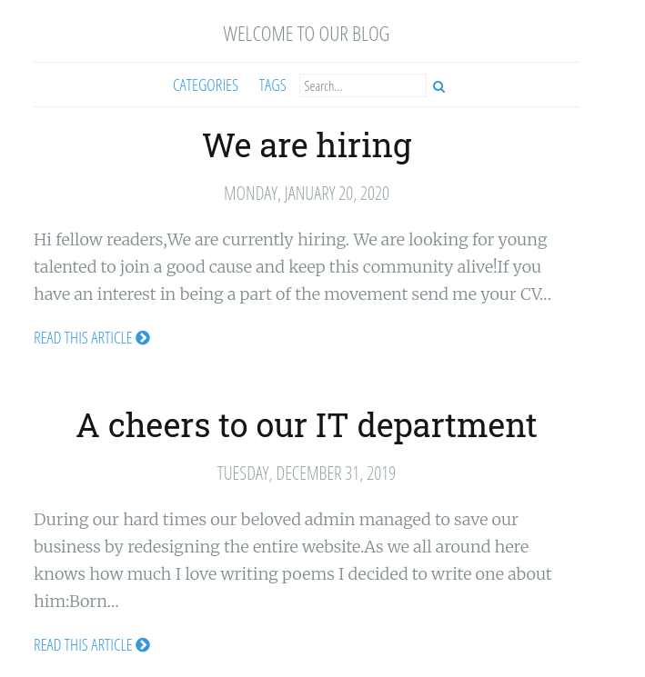

# Anthem

## Introduction

Add the received IP into `/etc/hosts`

```bash
10.49.153.226    anthem.thm
```

## Port Scan

The port Scan reveals two ports. One is a HTTP port, and the other is for Remote Desktop.

## HTTP

The HTTP is a Blog page.



## Password Leakage

`robots.txt` leaked the password and also the underlying Content Management System(CMS).


## Flag Leakages

Flags are scattered across the web pages. Use cURL to locate all of them.

## CMS

Web fuzzing tools like `feroxbuster` return many successful results for a particular CMS.


We can navigate and see the login page.


We need to find the valid credentials.

## OSINT

Previously, we found 2 blog posts. The first one is a hiring post.


We can see that `Jane Doe` has the email is `JD@anthem.com`. With this, we can do some OSINT and found out the name of the admin. 

Craft the correct email and combined with the found password to log in to the admin panel.


The admin panel reveals no useful information. We should move on to the remaining port.

## Password Reuse

Luckily for us, the user reused his password in the Windows account. We can take over his account with ease and get the user flag.


## Insecure File Permissions

A confidential file is hidden and not supposed to be viewed by others. 

However, we can change the permission to read the file and obtain the credential


Administrator is also compromised.


