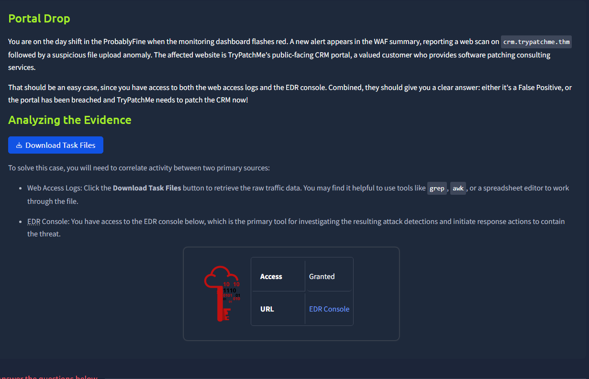

# Portal Drop



## Log Format

The file that we received is a log file. Inside it contains 685 entries

```bash
└─$ file access-combined-crm-1767978582478-1768841821765.log 
access-combined-crm-1767978582478-1768841821765.log: ASCII text

└─$ wc -l access-combined-crm-1767978582478-1768841821765.log 
685 access-combined-crm-1767978582478-1768841821765.log
```

The log file looks like the following:

```bash
└─$ head access-combined-crm-1767978582478-1768841821765.log 
64.233.177.99 - - [06/Nov/2025:14:15:00 +0000] "GET /CRM/portal/help/contact.php HTTP/1.1" 200 93 "https://crm.trypatchme.thm" "PF-API-Client/2.5"
185.199.108.133 - - [06/Nov/2025:14:15:01 +0000] "GET /CRM/profile/edit.php HTTP/1.1" 200 38 "https://crm.trypatchme.thm" "PF-API-Client/2.5"
197.51.100.22 - - [06/Nov/2025:14:15:02 +0000] "GET /CRM/portal/support.php HTTP/1.1" 200 93 "https://crm.trypatchme.thm" "Mozilla/5.0 (X11; Linux x86_64; rv:120.0) Firefox/120.0"
203.11.113.45 - - [06/Nov/2025:14:15:03 +0000] "GET /CRM/portal/profile.php HTTP/1.1" 200 82 "https://crm.trypatchme.thm" "PF-BusinessClient/3.1"
185.199.108.133 - - [06/Nov/2025:14:15:04 +0000] "GET /CRM/portal/assets/scripts/main.js HTTP/1.1" 200 38 "https://crm.trypatchme.thm" "Mozilla/5.0 (X11; Linux x86_64; rv:120.0) Firefox/120.0"
34.216.10.99 - - [06/Nov/2025:14:15:05 +0000] "GET /CRM/portal/export.php HTTP/1.1" 200 66 "https://crm.trypatchme.thm" "Mozilla/5.0 (Windows NT 10.0; Win64; x64) Chrome/120.0 Safari/537.36"
89.177.22.3 - - [06/Nov/2025:14:15:06 +0000] "GET /CRM/portal/search.php HTTP/1.1" 200 82 "https://crm.trypatchme.thm" "Mozilla/5.0 (Windows NT 10.0; Win64; x64) Chrome/120.0 Safari/537.36"
64.233.177.99 - - [06/Nov/2025:14:15:07 +0000] "GET /CRM/portal/invoices.php HTTP/1.1" 200 93 "https://crm.trypatchme.thm" "Mozilla/5.0 (X11; Linux x86_64; rv:120.0) Firefox/120.0"
54.201.10.55 - - [06/Nov/2025:14:15:08 +0000] "POST /CRM/tax/export.php HTTP/1.1" 200 563 "https://crm.trypatchme.thm" "PF-API-Client/2.5"
34.216.10.99 - - [06/Nov/2025:14:15:09 +0000] "GET /CRM/portal/export.php HTTP/1.1" 200 66 "https://crm.trypatchme.thm" "Mozilla/5.0 (Windows NT 10.0; Win64; x64) Chrome/120.0 Safari/537.36"
```

Notice that spaces are used as a delimiter. Therefore we can use the `cut` command to extract fields easily.

For example, here is all the IPs and the occurances in the log

```bash
└─$ cat access-combined-crm-1767978582478-1768841821765.log| cut -d ' ' -f 1|sort| uniq -c
     44 104.16.123.96
     47 151.101.1.140
     50 18.205.93.1
     34 185.199.108.133
     34 192.10.2.77
     51 197.51.100.22
     42 203.11.113.45
     47 23.20.239.12
     46 34.216.10.99
     27 34.67.91.83
     34 35.180.10.10
     41 43.132.0.77
     55 52.95.245.33
     39 54.201.10.55
     38 64.233.177.99
     56 89.177.22.3

```

## Login Brute Force

Upon viewing the logs, we found some entries involved POST requests to `login.php` with 401 (Unauthorized), which indicated failed login attempts.

```bash
"POST /CRM/login.php HTTP/1.1" 401
```

To check these failed attempts, we can find the entries containing `POST /CRM/login.php HTTP/1.1" 401`, and extract the IPs.

```bash
└─$ cat access-combined-crm-1767978582478-1768841821765.log| grep '"POST /CRM/login.php HTTP/1.1" 401'|cut -d ' ' -f 1|sort|uniq -c
```

Not all failed attempts are malicious, but a high occurance of 401 from the same IP adress might be a clear sign of bruteforce.

Similarly, we can look at the number of succssful logins (200) and failed attempts using the following:

Successful Logins

```bash
└─$ cat access-combined-crm-1767978582478-1768841821765.log| grep '"POST /CRM/login.php HTTP/1.1" 200'| wc -l
```

Failed Attempts

```bash
└─$ cat access-combined-crm-1767978582478-1768841821765.log| grep '"POST /CRM/login.php HTTP/1.1" 401'| wc -l  
```

## Payload Uploads

We are told that the threat attacker had also uploaded files.

The logs involves entries with `POST /CRM/portal/upload.php`, which should include the attacker’s activities.

The below commands tries to find the 12th field (user agent) as it reveals what the attacker used to interact with the file upload.

```bash
└─$ cat access-combined-crm-1767978582478-1768841821765.log| grep "POST /CRM/portal/upload.php HTTP/1.1"|grep xx.xx.xx.xx|cut -d ' ' -f 12|uniq            
```

The logs stops here, only showing that the attacker sends a POST request, without any further details.

To learn more, we have to go to the given EDR.


We see some detections with high severity, which is not a good sign. My guess is, the attacker first brute force a valid account credentials, then use it to access to the file upload web page and uplaod the payload, and use it to execute commands.

In the suspicious File Write, we saw there is a risky file write being flagged


Then the attacker access to it twice.

```bash
└─$ cat access-combined-crm-1767978582478-1768841821765.log| grep "/CRM/portal/uploads/xxxxxxxxx.xxx"|cut -d ' ' -f 1
xx.xx.xx.xx
xx.xx.xx.xx
```

Within the requests, we found parameter `q` which contains base64-like encoded strings. They require two layers of base64 decode.


The first command is a harmless comamnd, and the second one established a reverse shell connection.

Using this, The attacker achieve Persistence in [MITRE ATT&CK](https://attack.mitre.org/tactics/TA0003/) as he can execute comands and maintain a foothold.

## Reverse Shell and Command Execution

To trace the Reverse Shell and the commands executed, we have to take a look at the Shell Spawn Detection. It contains the Process Image, A IP address, and the shell command.


We can also see the details of the first command execution


## Data Exfiltration

After established a shell, the attacker harvest on the available data.

The attacker first enumerate about the environment using `uname` and `ip`

After that, it starts to use `find` to locate the interesting files, and use `cat` to read one of configuration file.


After that, it targets the data of TryCRM, a Customer Relationship Management (CRM) software. The `.idx` is a index file used by the AI agents, which might contain sensitive data.

The attacker use curl to upload the database and the index file to his domain.


With this, we have tidy up the attacker’s attack path and method, and can prepare for mitigations.
