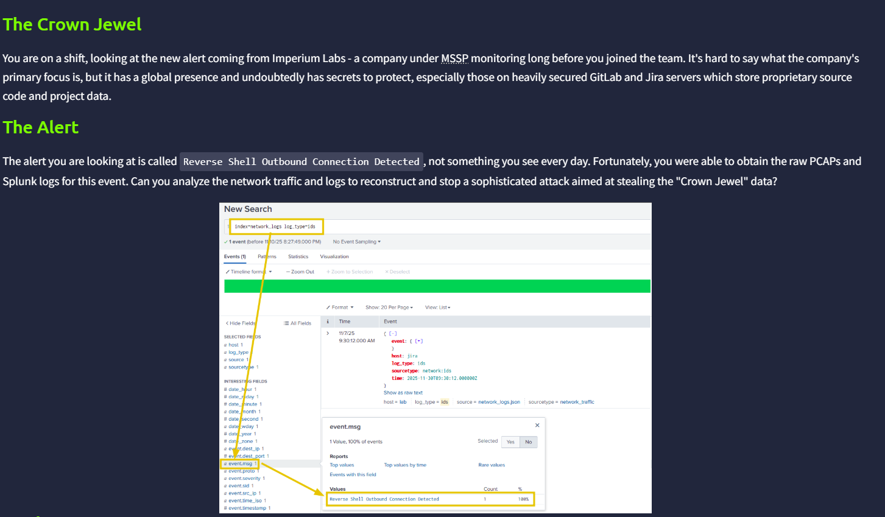

# The Crown Jewel

## Introduction

---

## Reverse Shell Connection

There is only one event with Reverse Shell Outbound Connection Detected

We can see that an internal IP is flagged to have a Reverse Shell Outbound Connection to a very infamous IP. And I believe it is a false positive.

---

## ARP Spoofing

We were told that there is MAC address Impersonating, which should be related to ARP.

ARP is used to find the MAC address of an IP. A user will broadcast a ARP Request message to ask for a certain MAC address of an IP address. Ideally, only the device having that IP will response back. However, because everyone can receive the message, an attacker can reply a malicious MAC address back to the sender, which is exactly the case.

We can focus on the `arp` log type and count the sender MAC address. Luckily for us, there is only one unique MAC address.

We can see a better picture in Wireshark. You can see that `10.10.10.1` and `10.10.10.150` are being impersonated a lot.

A valid ARP request and Response can be found in [Geeks for Geeks](https://www.geeksforgeeks.org/ethical-hacking/arp-in-wireshark/). And strangely, I can not find any occurrence of ARP request.

---

## Suspicious User Agent

We can see a weird user agent record in one of the request to Jira. It indicates the possibility that an exploit is involved in this request.

---

## Plain Text Credentials Flying in the Request

There is a sole POST request in the Wireshark capture. Inside it, we found a set of credentials.

---

## Data Exfiltration

The threat actor concluded with a data exfiltration. In protocol hierarchy, we found a very common protocol is used to perform the work.

Inspect the traffic, we can also find the domain used by the attacker.